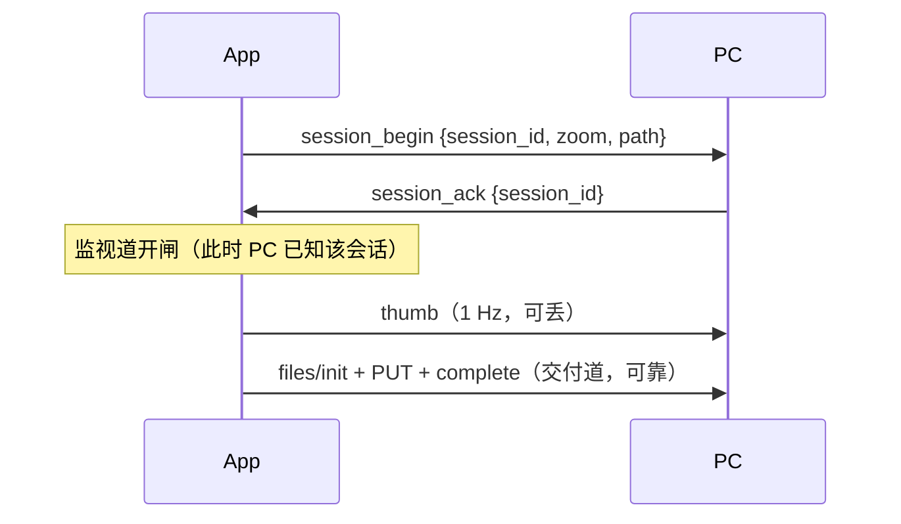

# PC 端接收服务（M1）

设计依据：`手机相机采集与回传_方案设计.md` §4.1（双车道）、§6.1–6.3（aiohttp / 发现配对 / 落盘规范）、§7（协议）。

## 依赖与运行

```bash
# 依赖（仓库根目录 requirements.txt；二维码支持见 requirements-optional.txt）
python -m pip install -r ..\requirements.txt

# 启动（默认端口 8765，数据落到 ./pc/data）
python pc\server.py
#   可选：--port 8765  --max-mbps 40  --profile pc\profile.json  --token xxxx
```

启动后终端会打印：

```
  数据目录 : ...\pc\data
  profile  : m1-default = {"output_size":[1920,1440], "format":"YUV_Y", ...}
  限速     : 40.0 MB/s
  手机 App 连接方式（任选）：
    ① 扫码：App 里点「扫码配对」，对着下面这个二维码（面板顶部也有同一个）
    ② 粘贴：把下面【首选】那一行整行 URL 粘进地址框（token 会自动带上）
    ③ 手输：只填 ip:port，再单独填 token
    【首选】 http://192.168.x.x:8765/?token=ab12cd34   [WLAN]
  配对码（含义：地址 192.168.x.x:8765 + token，扫它等于拿到凭据，别外传）：
  <二维码>
  配对码原文（设备不支持扫码时可手抄）：m0probe://pair?h=192.168.x.x&p=8765&t=ab12cd34
```

手机 App（`android/m0probe`，v1.11.1）底部「交付会话」区：
点 **扫码配对**（对准上面的码，自动填地址与 token 并连接），
或手填 `192.168.x.x:8765` + `ab12cd34` → **连接 PC** → 点 **开流交付**，
或在浏览器打开 `http://127.0.0.1:8765/` 点「▶ 开始采集」远程下发 `start`。

> ⚠ **Windows 防火墙**：首次启动会弹"是否允许 python 通过防火墙"，必须允许**专用网络**。
> 手机与 PC 必须在同一网段（自备路由器或手机热点；若路由器开了 AP 隔离，见方案 §R4）。
> 扫码配对的契约、判据与"扫不出来怎么办"见 **[`docs/扫码配对.md`](../docs/扫码配对.md)**。

## 面板

`http://127.0.0.1:8765/`（浏览器；token 已内嵌在页面里）：

- 「▶ 开始采集」→ 新建 session 并向 App 下发 `start`（含留存/降载 plan；**默认 `interval_ms=0` = 不抽帧 = 每一帧都留**）
- **「采集模式」下拉框（`deliver` / `live`）** → 决定这条会话是**每一帧都留**还是**只看不留**。
  ⚠ 它是**会话性质**、不是画质档：选 `live` 后交付道整体关闭（不落盘），跑完**什么都不剩**
  （所以选了 `live` 再点 ▶，提示里会有一句红字警告）。两个选项的取值与 `MODES` 的一致性
  由判据 `A9m` **从模式集合自身推导**（加第三种模式忘了改面板 ⇒ 立刻红）。
- 「■ 停止」→ 下发 `stop`
- 会话表：帧数（已验证/声明）、字节、缩略图数（**收到 N 张**）、**断言**
  （calib_id 一致 / 参数漂移 / 温度区间 / **交付收尾三态**）
  ⚠ **live 会话那一行走的是另一套渲染**：留存列显示「**不适用** live 零留存」+ 实时道账本
  （PC 实收 / App 宣告 / 跳过（陈帧·设计内）/ 异常丢 分开摆），而不是一串「判不了」。
- 顶部「监视道」区块：最新缩略图 + **通道状态**（推送 / 轮询）+ **收到 / 渲染 / 合并** 三个数
  —— 三个数分别记账，差额会显式解释，不会让 1:3 这类比例无声出现。
  ⚠ **live 模式下 App 不推 thumb**，这一格会写明「live 模式下 App 不推 thumb（监视道让位给实时道）」
  —— 否则"监视道不动了"会被读成"监视道坏了"，而其实是"本模式没有它"。
- **「实时道」区块**（`capture_mode=live` 才有画面）：彩色 MJPEG 直接内嵌
  （``，浏览器原生解析 multipart，零 JS 开销、自动丢旧帧）。
  ⚠ 这条流**需 token 且仅本机可读**（`/stream/*` 在 loopback 名单里）⇒
  **用手机浏览器打开面板时它是空的**（那时看上面的监视道）；本机看是正常的。
- 若显示「⚠ 没有 App 在线」= WS 没连上，先查 App 里的地址与 token
  （⚠ 面板自己的推送通道**不计入**这个数：刷新页面不会被当成设备掉线）

## App 端状态字段（WS `status`）

```json
{"type":"status","session_id":"…","state":"running|idle","queue_len":38,
 "queue_bytes":104857600,"queue_sessions":2,
 "storage_free_mb":20892,"temperature_c":32.3,"frames_delivered":67}
```

| 字段 | 看什么 |
|---|---|
| `queue_len` / `queue_bytes` | **先涨后降**才是正常（涨=在采、降=在上传并删除）。只涨不降 ⇒ 上传没跑 |
| `queue_sessions` | 队列里涉及几个会话。**>1 说明还有跨会话残留**（正常会被逐步补传清空） |
| `queue_legacy_names` | 队列里**旧命名**（`frame_000123.yuv`，没有 `session_id__` 前缀）的帧数。它们仍能正常补传（会话号在各自的元数据里），单独计数只是为了不把每个旧文件名都算成一个"会话" |
| `frames_delivered` | App 侧累计**决定留存并成功入队**的帧数（与 PC 的 `frames_verified` 对比，差值是积压量）。默认档下 ≈ 相机产出的全部帧 |
| `state` | `idle` / `running`（按 sensor 节奏采；**默认不抽帧，每一帧都留**） |
| `capture_mode` | **`deliver`（默认，每一帧都留）/ `live`（只看不留，见「实时道」一节）**。⚠ 非法取值会被服务端显式拒（400 `bad_capture_mode`） |
| `live` | **v1.15.0**：live 模式下的实时道账本（`sent` / `skipped_est` / `dropped` / `bytes` / `mbps` / `fps_actual` / `latency_ms` / `latency_avg_ms` / `color` / `path_id` / `path_rev`）。`deliver` 模式下为空 |
| `upload_mbps` | **最近 10 s 实测上传速率**。这是"交付跟不跟得上"的唯一直接数 |
| `backlog_fps` | 最近 60 s 队列增长速率（帧/s）。**>0 且开流中 ⇒ 采集快于交付** |
| `eta_full_min` | 按当前积压速度写满剩余空间的分钟数（`-1` = 没有积压） |
| `linktest_mbps` | 最近一次「链路测速」结果（`-1` = 没测过） |
| `sample_fps` | 最近 10 s **决定留存**的速率（帧/s）。默认档下 ≈ 相机出帧率；与 `plan_interval_ms` 对照可看出"请求的节奏"是否真达到 |
| `deliver_fps` | 最近 10 s **成功入队**的速率（帧/s）。`< sample_fps` ⇒ 有帧"决定了留却等不到图" |
| `samples_lost` | 累计"已决定留存但等不到对应图像"的帧数（**静默少帧的账本**，>0 时 App 日志会点名；第 24 轮起四条丢帧路径都会进账本） |
| `plan_interval_ms` | 当前留存间隔（**0 = 不抽帧 = 每一帧都留**，默认；>0 是降载） |
| `thumbs_enqueued` / `thumbs_sent` | 交给发送线程的 / **真正发出去**的缩略图数。旧代码把"入队"当"发出"，于是"手机说发了 30、电脑收到 28"**永远对不上账** |
| `thumbs_send_failed` / `thumbs_dropped` | 发出时抛异常 / 被挤掉的张数（含"未连接、会话未确认、图异常"） |
| `thumbs_gated` | 因"会话尚未被 PC 确认"而暂缓发送的缩略图数（正常 0–2 张，`session_ack` 到达后自动开闸） |
| `thumbs_rejected` | 被 PC 明确拒收（`thumb_rejected`）的次数。**>0 说明闸门与 PC 状态不一致**，App 会自己关闸并重声明 |
| `drain_state` | 交付收尾状态：`drained`（**已传完**）/ `draining`（在传）/ `blocked`（有积压且传不动）/ `idle`（没活）。⚠ `drained` 与 `idle` 必须分开，否则"传完了"和"什么都没发生"长得一样 |
| `delivery_alive` | 交付道线程是否仍在工作。**与 `connected` 无关** —— 控制道断了它照样该是 `true` |
| `uploaded_frames` | 本会话已 `verified` 并删除本地的帧数（与 `frames_delivered`＝留存帧数 对比，"留了没传"一眼可见） |
| `upload_fail_streak` / `delivery_done_announced` | 连续上传失败次数 / 收尾宣告是否已发出 |
| `session_confirmed` | PC 是否已确认当前会话（`session_ack` 或本会话首帧 verified） |
| `meta_missing_result` | 累计"已留存但结果对象缺席"的帧数（那些帧缺 skew/镜头/曝光 等字段）。**正常为 0** |

> 队列是**全局一个**（`delivery/queue/`），不按会话切 —— 这样断网/换会话后仍能补传；
> 每帧属于哪个会话写在它自己的元数据里，上传时用它自己的 `session_id` 归位。

## App 界面（v1.11.1 起）

自上而下的顺序（**按现场操作的先后排**，不再让辅助信息挤掉按钮）：

```
① 标题 + 状态栏（连接结果、交付状态都写在这里）
② 预览画面（灰度 Y 平面 + 中心十字，高度封顶 ≤ 屏高 30%）
③ 交付会话
     地址框（可粘整行 URL / 配对码，token 自动带上）  [token 框]
     [ 扫码配对 ]（长按 = 解析器自检；扫码后自动填表并连接）
     [ 连接 PC ] [ 断开 ]
     [ 开流交付 ] [ 停流 ] [ 链路测速 ]
④ ▸ 展开 M0 探针（①③④⑤⑥，复采用）      ← 默认收起
⑤ 日志（只保留最近 400 行）
```

扫码走独立界面（`QrScanActivity`，后摄预览 + 实时解码）：

- 采集运行中点扫码会被拦下（后摄被占用 ⇒ 开了也黑屏），并说明"先停流"；
- 扫到码会响一声再返回，避免用户一直举着手机；
- 界面上有"已看 N 帧 / 解码 M 次"——扫不出来时用它区分"相机没给帧"和"确实解不出"。

**按钮可用状态由状态决定**（不能靠用户猜）：

| 状态 | 连接 | 断开 | 开流 | 停流 |
|---|---|---|---|---|
| 未连接 | ✅ | — | — | — |
| 连接中… | — | ✅（可取消） | — | — |
| 已连接 | — | ✅ | ✅ | ✅ |

> 为什么"连接"和"断开"是两个按钮：以前是一个按钮改文字，而成功分支只改了状态栏、
> 没把文字改成「断开」⇒ **连上之后断开入口根本没出现过**（现场实测）。

**连接的三种结局都要有明确出口**（状态栏 + 按钮复位）：

| 事件 | 界面表现 | 谁触发 |
|---|---|---|
| 握手成功 | 状态栏「已连接 PC」，开流/停流变可点 | WS 收到 `HTTP/1.1 101` 时回调（`onOpen`） |
| 连接失败 | 状态栏「连接失败：…」，回到只能点「连接」 | HTTP 探测失败 / 握手 403（token 不符） |
| **连接意外丢失** | 状态栏「连接已断开：…」，停采集、回到只能点「连接」 | WS 读到 EOF / close 帧 / 读写异常 |

> ⚠ **连接成功必须显式上报**。曾经只有失败路径回调，成功时按钮**永远是灰的**
> ——现场表现是"电脑端一直有输出、App 点不动"（实测踩到）。

**会话号在两种开流方式下不同**：PC 面板点「开始采集」时，PC 生成会话号并用 `start`
下发，App 采纳它；而 App 上点「开流交付」时，若当前会话号是 PC 上一次分配的，
App 会**换一个新的**——否则这批帧会被上传进 PC 那边已经结束的会话目录，把两轮采集
混进同一份 `manifest`（断言会被静默污染）。

### 预览（App 端）

预览是**用已采到的 Y 平面**降采样渲染的灰度图 + 中心十字准线，约 8 fps，
用来现场把目标摆进画面。它**不新增 Surface**（多一个 Surface 就改了会话配置，属采集行为变更），
所以对采集、元数据、指纹、`rev` 全无影响 —— 纯粹是把已经在手的帧画出来。
高度封顶（`min(260dp, 屏高30%)`）：预览是辅助，不能把下面的按钮挤出屏幕
（这一条是踩出来的 —— 原来固定 240dp 且插在连接按钮**之前**，小屏上按钮全被挤没了）。

### 为什么要收起而不是删掉 M0 探针

①③④⑤⑥ 是 **M0 证据链的采集入口**，M0 的每条结论都挂在"哪份报告对应哪条采集路径 `(id, rev)`"上
（`tools/capture_path_versions.json`）。删掉代码就再也采不出等价证据 ——
将来只要动一次采集行为，或要给第二台机器复测，就得把这套探针重写。
所以默认收起（界面上不占位置），点一下即可展开复采。


```
pc/data/sessions/<session_id>/
  manifest.json          会话级：设备、profile、交付路线、断言结果
  frames/
    frame_000001.yuv     交付图像（Y 平面，紧密排布；宽度/步长见同名 json）
    frame_000001.json    帧级相机状态 + sha256 + 服务端校验信息
  thumbs/                监视道缩略图（可随时清理）
  incoming/<file_id>.part 分片暂存区（断点续传靠它定位偏移）
  logs/upload.log
```

**读图注意**：`.yuv` 是**纯 Y 平面**（`format=YUV_Y`），尺寸与 `y_stride` 在同名 json 里；
`repacked=true` 表示 App 已把 HAL 的补齐行去掉（下游按 `width` 读即可）。

## PC 主控：启动与关断是闭环的

面板上的「▶ 开始采集 / ■ 停止」不只是"发一条指令"：

```
PC                                      App
 │  POST /api/v1/control/start           │
 │  （新建 session，state=armed）          │
 │ ──────── WS start {session_id, plan, profile} ────────▶│
 │                                        │  openCamera → setRepeatingRequest
 │ ◀──────── WS start_ack {ok:true, output_size:…} ──────│  相机真的开了
 │  state=running                          │
 │                                        │
 │  POST /api/v1/control/stop             │
 │ ──────── WS stop ─────────────────────────────────────▶│  stopCapture
 │ ◀──────── WS stop_ack {frames_delivered:44, queue_len:51}│  停在哪
```

**为什么要回执**：没有它，`start`/`stop` 就是**单向广播** —— PC 只知道"WS 发送成功"。
相机打开失败（设备瞬时故障、被别的应用占用）时面板会一直显示 `running`，
而实际什么都没采到。现在：

| 情形 | 面板显示 |
|---|---|
| 相机开流成功 | 状态列 `running` + **相机已开流** |
| 相机打开失败 | 状态列 **`start_failed`** + 失败原因（如 `摄像头被断开`） |
| 正常停止 | 状态列 `stopped` + **已停：留存 N，队列剩 M**（`will_drain=true` = 停采集但把队列传完） |

`start_ack` 只在 **PC 主控**（App 收到 `start`）时回；手机上自己按「开流交付」不回执 ——
免得把"用户自己按的"也报成"PC 启动的"。

## 开流门控（profile 是否真的生效）

**profile 是 PC 下发的意图，回读是设备的事实。** 两者不一致时（典型：zoom 被 HAL 拒、
输出尺寸被改），数据照样在流，但"这批数据是按什么配置采的"就已经是错的了。
所以 PC 在该会话**第一帧带完整回读字段的帧** verified 时做门控（`manifest.start_gate`）：

| 类别 | 键 | 结果 |
|---|---|---|
| **硬、语义不一致** | `zoom_ratio`、`ois`、`eis`、输出尺寸、格式 | `status=fail` ⇒ **自动下发 `stop`**，会话标 `gate_failed`，面板红字点名失败项 |
| 软（只记注记） | 对焦距离、曝光时间、ISO | 只写 `soft_notes`（HAL 会量化/覆盖它们） |
| 回读缺席 | 上述硬键任意一个 | `status=incomplete` + `unevaluable` 列表，**只标记不停流**，下一帧补齐后自动复判 |
| 无帧可判 | — | `status=incomplete`（**判不了 ≠ 通过**） |

必须遵守的四条纪律（都在代码注释里）：

1. **profile 里写 0/None 的键 = "不指定"**：`zoom_ratio: 0` 的语义是"由 App 界面档位决定"
   ⇒ 门控**跳过**并记注记。否则默认配置下门控会永远失败（这就是"判据结论超出证据"）。
2. **门控失败的动作是停流，不是改配置重开** —— 要不要改配置是人的决定。
3. **枚举按语义比，不按字符串比**：App 报 `"OFF(0)"`（名字+码），profile 写 `"OFF"`，
   两者语义相同 ⇒ 判一致，并在 `checks.<键>.normalized` 与注记里**留痕**。
   按字符串比会把写法差异当成事实差异 ⇒ 假失败 ⇒ 自动停流（第 20 轮实机现象："点了开始采集，
   画面刷一下就再也不动了"）。详见 `docs/开流门控与枚举比对.md`。
4. **判不了 ≠ 有问题**：回读缺席是**取证不足**，不是配置错。`fail` 才停流；
   `incomplete` 只标记并要求下一帧复判（`gate_checked` 不冻结在 incomplete 上）。

⚠ `ois`/`eis` 是**锁定配方的断言，不是可调旋钮**：App 侧的请求里稳定器恒为 OFF
（M0 ② 的锁定配方）。把这两个键写成 ON 不会生效，门控会判 fail 并停流。

## 交付速率与链路诊断（实测）

**现场第一组数据（1920×1440，每帧 2.76 MB）**：

| 环节 | 实测 | 备注 |
|---|---|---|
| 手机 → PC 实际交付 | **≈5.5 MB/s ≈ 2.0 帧/s** | App 队列斜率与 PC `VERIFIED` 时间戳两处独立吻合 |
| PC 回环协议天花板 | **39 MB/s**（4 帧并行 51 MB/s） | `python pc/probe_throughput.py` |
| 默认限速档（`--max-mbps 40`） | 39.5 MB/s | 修令牌桶后与标签一致 |

⇒ **瓶颈在 WiFi 链路或手机端，不在协议**（差距 7 倍；分片大小与并发在回环上的收益 <2×，
所以改协议不会有效）。

**`pc/probe_throughput.py`** 用与 App 逐字段相同的请求序列打回环，把
"协议能跑多快"与"链路能跑多快"分开：

```bash
python pc/probe_throughput.py                          # 回环，不限速（协议天花板）
python pc/probe_throughput.py --max-mbps 40            # 带上现场默认的限速
python pc/probe_throughput.py --frames 60 --parallel 4 # 看并发是否有帮助
```

**App 侧「链路测速」按钮**（相机不开，灌 20 MB 到 `/api/v1/linktest`，服务端只收不落盘）
回答另一半：若它与交付速率一样低 ⇒ 链路受限；若明显更高 ⇒ 瓶颈在手机端采集循环。

### 限速的真实语义

`--max-mbps` 是**令牌桶**（允许 0.25 s 的突发额度），长期平均速率才等于标签值；
`0` 表示不限速。⚠ 旧实现是"每请求固定 `sleep(nbytes/rate)`"，实测把 40 MB/s 档压到
**17.6 MB/s** —— 当时横幅上的数字是误导的（已修，长跑复测 39.5 MB/s）。

### 降载旋钮：抽帧间隔会被量化到帧栅格（**请求值 ≠ 实际落点**）

> ⚠ 第 24 轮起**默认不抽帧**（`interval_ms=0` = 每一帧都留），本节只在**用了降载旋钮**
> 把 `interval_ms` 设成 > 0 时才适用。一旦用了，账本里 `every_frame` 变 `false`
> —— **语义不再是"每一帧都留"，这一点必须在数据里可见**。

抽帧规则是"取第一个与上次样本相隔 ≥ interval 的帧"，而帧只存在于 33.288 ms 的栅格上
（本机 30.04 fps）⇒ **实际落点 = ceil(interval / 帧周期) × 帧周期**：

| 请求 `interval_ms` | 实际落点 | 实际帧率 | 想要该帧率应设 |
|---|---|---|---|
| 200 | 233.0 ms（第 7 帧） | **4.29 fps** | **199** |
| 500 | 532.6 ms（第 16 帧） | 1.88 fps | 499 |
| 1000 | 1031.9 ms（第 31 帧） | 0.97 fps | 998 |

200 那一行最容易踩：6 个帧周期只有 199.7 ms，差 0.3 ms 没够上 ⇒ 请求 5 fps 实得 4.29 fps，
**链路上没有任何地方会报错**。App 开流时会打印这条换算并给出建议值
（`抽帧落点：请求 200 ms ≈ 栅格的 6.01 倍 ⇒ 实际落在第 7 帧后 = 233.0 ms（4.29 fps）；若要 5.0 fps，interval_ms 应设为 199`）。
⇒ **定档时 `interval_ms` 应取"帧周期的整数倍再往下取整"，不要填漂亮的十进制数。**

### 档位怎么选（App 界面 / PC profile）

App 交付区有 **`● 0.6× 超广角` / `○ 1.0× 主摄`** 两个按钮，**默认 0.6×**（定位需求）。

| 谁定 | 规则 |
|---|---|
| **PC `profile.zoom_ratio > 0`** | 用它（操作台显式指定，例如 `--profile` 里写死 0.6 或 1.0） |
| **PC 值为 0 / 缺省** | 用 **App 界面上的档位**（默认 0.6×） |

> PC 的默认 profile 里 `zoom_ratio` 是 **0 = 不指定** —— 0.6× 与 1.0× 是**两颗物理镜头**，
> 谁在机器旁边谁最清楚该用哪一颗；PC 默默压成 1.0 会让手机上的选择形同虚设。
> 生效值与来源逐帧记进元数据（`requested.zoom_ratio` + `zoom_source`），面板「镜头/变焦」列可见。

**运行中切档**：会自动「停流 → 换新会话号 → 重开」—— 换档=换镜头=换内参，
同一段会话里混两套内参会让 manifest 的断言面对两个真相（画面/时间戳/参数回读全都正常）。

### 变焦与换镜（0.6×）

`profile.zoom_ratio`（默认 1.0）直接下发到 `CONTROL_ZOOM_RATIO`。本机是**逻辑相机**
（3 颗物理镜头融合），区间 **[0.6, 10]** —— 但 **0.6× 不是"主摄缩小"，而是切到超广角**：

| zoom | 生效镜头 | 等效焦距 | 满幅 fx | 1920 宽输出 fx |
|---|---|---|---|---|
| 1.0 | id=2 主摄 | 23.1 mm | 2736 px | **1283 px** |
| **0.6** | **id=3 超广角** | 14.3 mm | 1688 px | 约 **794 px** |

⇒ 视场大 1.6 倍（现场摆位方便），但亚像素精度的角分辨率下降约 1.6 倍，且**内参/畸变/读出时间
都要重新测**。所以 `zoom≠1.0` 的数据**必须单独标定、单独取证**（主摄的结论不可外推）。

每份数据现在自描述这件事（`manifest.json` 的 `lens` 段 + 会话摘要）：

| 字段 | 含义 |
|---|---|
| `active_physical_id_distinct` | 本会话出现过的生效镜头（正常只有 1 个） |
| `active_physical_id_unique` | `false` ⇒ **这段数据分属两套内参**，下游须按镜头分段 |
| `zoom_requested_distinct` / `zoom_readback_distinct` | 请求值 vs 逐帧回读值 |
| `zoom_match` | `false` ⇒ 请求的变焦**没被采纳**（例如请求 0.6 但回读 1.0） |
| `lens_changes_peak` | 会话内换镜次数（App 日志会同时打出 `⚠ 会话内换镜：2 → 3`） |

> `active_physical_id` 与 `zoom_ratio` 本来就在 `assertions.param_drift` 的字段清单里，
> 所以换镜/变焦同时也会出现在漂移断言里 —— 两个口径互为印证。

### 元数据完整度（`manifest.meta_quality`）

每份会话的 manifest 里有一段 `meta_quality`，逐项统计"有多少帧缺来自 `CaptureResult` 的字段"：

```json
{"frames": 44,
 "missing": {"rolling_shutter_skew_ns": 28, "active_physical_id": 28, "zoom_ratio": 28,
             "crop_region": 28, "exposure_time_ns": 28, "iso": 28},
 "flagged_result_missing": 0,
 "ok": false}
```

`ok=false` 时 **不要**把这些帧的 `None` 当数值参与聚合（"平均 skew"会被拉偏），
涉及 skew / 换镜的结论应只用 `ok=true` 的会话。

> 为什么要专门有这一段：这类缺失是**静默**的 —— 画面、时间戳、字节数、计数器全都正常。
> 实测（v1.10.5 之前）某会话 **44 帧里 28 帧（64%）**缺整组字段而无人察觉。
> 详情与复验方法见 `docs/元数据完整度与结果对象丢失.md`。

### 积压（采集率 > 交付率）

开流时若交付跟不上，本地队列会持续增长（实测一次开流里 `queue_len` 162 → 249）。
App 会在日志里告警一次（含"约 N 分钟后写满剩余空间"），状态栏显示
`上传 X MB/s / 积压 ±Y 帧/s`。处置三选一：**开降载旋钮**（`plan.interval_ms`，最省事，
但语义会从"每一帧都留"退回"只留一部分"）、**换 5 GHz/有线**、**减小输出尺寸**。
拿不准时先点「链路测速」。

> ⚠ 默认档（不抽帧）下这个告警**更容易触发**：83.0 MB/s 的产出对 5.5 MB/s 的链路，
> 想不积压只能靠"边采边传 + 停采后排空"。所以默认档下**必须**看
> `backlog_fps` 与 `store.frames_stored_on_device` 对 `frames_verified_on_pc` 的差。

## 双车道：监视道（缩略图）+ 交付道（全质量图）

D6 的两条车道各司其职：**监视道**给现场看取景（秒级、可丢），**交付道**保证数据完整（批量、可靠）。
实测交付 ≈2 fps 时，监视道仍按 1 Hz 刷新 —— 这正是把两者分开的意义。

> ⚠ **v1.15.0 起的第三条道**：`capture_mode=live`（**只看不留**、允许彩色、串行闭环）。
> 它**不是**"监视道的替代"，而是**整条会话性质的切换**——开启时上面的交付道整体关闭。
> 详见本文档的「实时道」一节与 `docs/对外接口与单一交付道.md` §1.1。

| 项 | 监视道 | 交付道 |
|---|---|---|
| 载荷 | 480 宽灰度 JPEG（20–40 KB，保留中心十字） | 1920×1440 纯 Y 平面（2.76 MB/帧） |
| 通道 | WS 文本帧（base64，`thumb`） | HTTP 分片 + 续传 + SHA-256 终检 |
| 节奏 | 1 Hz | 实测 ≈2 fps |
| 可靠性 | **可丢**：不排队、不落盘、断开即丢 | 落持久队列，`verified` 才删本地 |
| PC 落盘 | `thumbs/thumb_<seq>.jpg` + 旁挂 `.json`，**只留最新 200 张** | `frames/frame_<seq>.yuv` + `.json` |
| 带宽 | ≈0.4 Mbps（可忽略） | 占满实测链路（44–93 Mbps 量级） |

**看画面**：面板顶部「监视道」区块实时显示最新缩略图；也可直接取文件：

```bash
curl -o t.jpg "http://127.0.0.1:8765/api/v1/sessions/<session_id>/thumb/latest"
```

### 面板是**推送**的（v1.11.0）

面板原来 3 s 轮询"拉一张最新图"，而缩略图是 1 Hz ⇒ 用户看到 **"接收计数 +3、画面只更新 1 张"**
（比例正好 1:3），合理地怀疑丢了 2/3。**数据一张没丢**（`thumbs` 是逐张落盘数），
是**采样口径**骗了人。现在：

- 面板连 `/ws/panel`，PC **收到 thumb 就内联推给面板** ⇒ 收到即渲染，帧率与 App 一致；
- 前端分列 **`收到 / 渲染 / 合并`**，差额显式解释（合并 = 解码未完就被新图顶替，
  监视道取"最新帧"语义）；推送断了**退回轮询**并在通道状态里写明"轮询模式（帧率会被节流）"。

⚠ **推送必须非阻塞**：它是在 **App 的控制道消息循环里**触发的（收到 thumb 就转发）。
第一版用 `await asyncio.wait_for(send_str, 1.0)` 加超时，**测试当场抓住**：
超时的取消顺着 `await` 冒泡，把 **App 的控制道连接整个掀掉**（手机端莫名"连接已断开"，
服务端什么错都不打）。现改为"每面板一个 2 格队列 + 独立发送任务"，
投递方只 `put_nowait` ⇒ 慢面板只丢自己的帧。**监视道可丢，控制道不可堵。**

### 会话是谁建立的（v1.10.5）

**控制道声明，交付道证明，监视道只负责显示**：



- 之前是"等交付道首帧 `verified` 再开闸"，但交付道是**队列**驱动的：连接后往往先补传
  上一个会话的积压帧，本会话首帧可能排在几十帧之后 ⇒ 监视道长时间黑屏，而且**旧会话的
  verified 会把闸门错开**（实测：`thumbs_gated: 0` 却仍被 PC 判"未知会话"）。
- 现在改由控制道即时声明；`thumb_rejected` 让 App 知道"PC 不认这个会话"（PC 重启后典型）
  并自动重声明（上限 3 次）。**PC 不会因为收到缩略图就建会话** —— 那会让陈旧/伪造缩略图
  凭空造出会话目录。

**三条硬约束**（代码注释里都写了理由）：

1. 缩略图**不进交付队列**（否则交付积压时监视道一起卡死 ⇒ 等于没分车道）；
2. **不在相机线程上发**（`send` 是阻塞写 socket，会拖住帧回调 ⇒ 扰动留存节奏）；
3. PC 端处理缩略图**永不抛异常，也不为未知会话建会话**（监视道的问题不得影响交付道，
   也不得凭空造出空会话目录）。

### 交付道独立于控制道（v1.11.0）：**停采集 ≠ 停交付**

双流不只是"两条路各走各的"，还包括**它们的生命周期互不绑定**。查代码时发现
`Uploader.run()` 的循环条件是 `while (connected)` —— 那等于把交付道的命脉交给控制道：

```
WS 一断（PC 重启 / WiFi 抖动 / 用户关面板 / 对端关闭）
  ⇒ connected=false ⇒ 上传线程立刻退出 ⇒ 队列里已抽好的帧**停在手机上不动了**
  ⇒ 而 HTTP 明明是通的（"实时联通结束"≠"不能回传"）
```

| 概念 | 现实现 |
|---|---|
| 上传线程循环条件 | `while (deliveryAlive)` —— **只有用户显式断开且队列已清空**才收工 |
| 意外掉线（`onConnectionLost`） | 只标记"控制道离线"，**交付道照跑**（失败就退避重试，文件一律保留） |
| 用户点「断开」 | 队列非空 ⇒ 进**收尾模式**（不采了，传完才收工）；队列空 ⇒ 立刻收工 |
| 线程重建判据 | **`uploader == null \|\| !uploader.isAlive`** —— 上一轮踩过的坑换形状又回来：收尾模式下线程会**正常退出而引用还在**，判据若还是"引用非空" ⇒ 重连后永远不重建，上传静默失效 |

**收尾的唯一一手证据是 `delivery_done`**（App 在"采集已停 + 队列空 + 本轮传过帧"
三条同时成立时宣告）。PC **不许**从"不再有新帧"推断收尾 —— 链路卡顿、App 被冻结、
旧会话串台都能骗过它。

`manifest.assertions.delivery_complete` 是**三态**（每条都能说出证据是哪几个字段）：

| 值 | 依据 | 面板 |
|---|---|---|
| `true` | 收到 `delivery_done`；或 `stop_ack` 说"抽 N 帧、队列 0"且 PC `verified ≥ N`，且停后无迟到帧 | `交付收尾 ✓` |
| `false` | 有 `stop_ack` 但队列有余量 / 停后仍有迟到帧 | `交付未收完` |
| `null` | 既无 `stop_ack` 也无 `delivery_done` ⇒ **PC 侧不可区分** | `交付收尾 判不了` |

停采集后到达的帧不是异常，而是**收尾的正常产物**，但要计数：
`stopped_at` + `late_frames_after_stop`（不计数的话，"明明停了怎么还在收"
就只能靠猜 —— 而它有两种完全不同的解释）。`stopped_at` 取 **`stop_ack`（回执）**，
不取"PC 下发 stop 的时刻"：**下发的指令是意图，回执才是事实**。

## HTTP 接口（§7.2）

| 方法 | 路径 | 说明 |
|---|---|---|
| POST | `/api/v1/files/init` | 声明文件 → `{file_id, resume_offset, chunk_max, kind}`。`kind` 缺省 = `frame`，且**只允许 `frame`**（第 24 轮合并后只有一条道）；旧客户端的 `kind=archive` ⇒ `400 lane_merged`。幂等键 = `(session_id, device_serial, seq)`，**不再含 `kind`**。⚠ **本端点不校验 token**（设备面开口，见 `docs/对外接口与单一交付道.md` §9） |
| PUT | `/api/v1/files/{file_id}` | 分片：`Content-Range: bytes a-b/total` + `X-Chunk-Crc32` |
| POST | `/api/v1/files/{file_id}/complete` | 提交整文件 `sha256`，通过才 `verified`。落盘只有一处：`frames/frame_%06d.yuv`（+ 同名 `.json`） |
| GET | `/api/v1/sessions` | 面板数据（含断言、`thumbs`/`thumb_latest`、`store` 账本） |
| POST | `/api/v1/control/{start\|stop}` | 启动/停止采集（= 面板「▶ 开始采集 / ■ 停止」）。⚠ **需 token**（`?token=` 或 `X-Token`）：**1.13.0 及以前的文档就写着要 token，但代码不查** ⇒ 同网段任何机器都能启停采集。1.13.1 起真的校验（对不带 token 的调用方是**不兼容变更**，所以版本号必须变） |
| GET | `/api/v1/pair` | **扫码配对**：`{url, host, port, token, hosts[], pair_uri, qr_svg, qr_matrix, qr_png_b64, qr_formats, note}` —— 配对的**三件套**（网址 / token / 二维码）一次给全，另有**全部网卡候选**。⚠ **必须带 `?token=`**（403 否则）—— 它返回的正是凭据，与"不返回凭据的读接口"性质不同 |
| GET | `/api/v1/sessions/{sid}/thumb/latest` | 监视道：最新一张缩略图（`image/jpeg`，`no-store`）。⚠ **本端点不校验 token 也不限本机**（有意保留，见 `docs/对外接口与单一交付道.md` §9） |
| POST | `/api/v1/linktest` | 链路测速：收下 body 即丢弃，回 `{bytes, seconds, mbps}`。⚠ **本端点不校验 token**（设备面开口） |
| POST | `/api/v1/live/frame` | **实时道帧入口**（v1.15.0，设备面）：body 是**裸 JPEG 字节**，header 带 `X-Session-Id` / `X-Seq` / `X-Sensor-Timestamp-Ns`。**只转 MJPEG，绝不落盘**。会话 `capture_mode != live` ⇒ **400 `mode_conflict`**；未知会话 ⇒ 404 且**不建目录**；非 JPEG ⇒ 400 `bad_payload`；超 4 MB ⇒ 413。⚠ **本端点不校验 token**（设备面开口，同 `files/*` 口径，见 `docs/…` §9） |
| GET | `/api/v1/capabilities` | **能力与版本声明**（v1.15.0，**无需 token**，不含凭据）：**三条道**（`lanes.monitor` / `lanes.delivery` / **`lanes.live`**）各是什么（含 `knobs` 与 `ledger` 字段表）、**`console.features`（控制台功能 ↔ 接口映射）**、`routes`（**从真实路由表导出**的端点清单）、各接口的鉴权与隔离要求。上位机启动时**先读它**，别硬编码假定"某个接口应该存在" |
| GET | `/api/v1/host/status` | **整机状态**（v1.15.0，需 token，**仅本机**）：`capture/device/gate/monitor/store/live/host_events/storage/sessions`。口径与面板**完全一致**（`gate.status` 三态原样透出，`incomplete` 不许写成 `pass`；`store.complete=null` = 判不了；⚠ **`capture_mode=live` 时 `store.applicable=false` 且 `delivery_complete=null` = 不适用**，见下） |
| GET/WS | `/api/v1/host/events` | **事件广播**（v1.15.0，需 token，**仅本机**）：连接即给一份 `hello`；之后 `session_started` / `frame_verified` / `gate` / `stopped` / `delivery_done` / `delivery_progress` / `delivery_aborted` 主动推。满队列丢最旧**并计数**（回发 `events_dropped`）；`delivery_progress` 节流 2 s 且带 `throttled_skipped` |
| GET | `/stream/mjpeg` | **实时画面**（v1.15.0，需 token，**仅本机**）：`multipart/x-mixed-replace`，`no-store`；接入即发"手上最新一张"。⚠ **有损可丢**，只用于"看得见"，任何测量必须走**交付道**。⚠ **`capture_mode=live` 的彩色帧也走这条管线**（监视道与实时道在此汇合，帧里带 `lane`/`color` 元数据） |

### 本机接口面的隔离：按**对端地址**判，不按 `Host` 头

`/api/v1/host/*`、`/stream/*` 只接受来自**回环地址**的请求
（`127.0.0.0/8`、`::1`、`::ffff:127.0.0.1`）。

- 为什么不能靠端口/路径区分：设备侧接口（`/api/v1/files/*`、`/ws`）**必须监听 `0.0.0.0`**
  才能让手机连上，两者**共用同一个端口** ⇒ 只能按对端地址判。
- 为什么不能按 `Host` / `X-Forwarded-For`：那是客户端**可任意伪造**的头，按它判等于没判。
- **拿不到对端地址 ⇒ 判"不是本机"（fail closed）**。反过来写（拿不到就放行）会让这层门控
  在某种部署下**静默失效**，而失效的表现是"局域网里另一台机器能读到状态和画面"，没有任何报错。
- **既有调试入口不受影响**（`/api/v1/sessions`、缩略图、面板、`/api/v1/pair`）——
  手机浏览器打开面板本身就是排查手册里的"5 秒判定法"，不能被误伤。

三行接入（`pc/hostlink.py`，只用标准库，不需要装包）：

```python
import sys; sys.path.insert(0, "pc")
from hostlink import HostLink
h = HostLink("http://127.0.0.1:8765", token="ab12cd34")   # 地址 + token（不是 port=，也没有 from_env）
print(h.status())                            # 整机状态
print(h.ledger())                            # 交付道账本（= host/status 的 store 段）
for ev in h.events():                        # 事件广播（自动重连，重连时 yield _reconnected）
    print(ev["type"])
print(h.mjpeg_url())                         # 交给 cv2.VideoCapture / ffmpeg / 
h.start(); h.stop()                          # 启停采集（等价于面板两个按钮）

# —— 面板（控制台）上的其余功能，同样都有对应方法（v1.15.0，见 capabilities.console）——
print(h.overview())                          # 面板顶部环境行：profile / 数据目录 / WS 客户端数
print(h.sessions()[0]["store"])              # 面板会话表那一行里的留存账本
p = h.pair()                                 # 配对三件套：网址 + token + 二维码（含全部网卡候选）
print(p["url"], p["token"], p["hosts"][0]["adapter"])
h.qr_png("pair.png")                         # 二维码落成 PNG（⚠ 图里有 token，等同凭据）
print(h.thumb_url())                         # 监视道最新一张（与面板轮询用的是同一条 URL）

# —— 接口能做、面板做不到的：开一个「只看不留」的实时会话（v1.15.0，彩色实时）——
h.start(capture_mode="live")                 # 面板上没有这个开关，必须显式选
print(h.status()["live"])                    # 实时道账本：frames_received / mbps_received / skipped_est
print(h.status()["store"]["applicable"])     # 预期 False（本会话没有留存这个概念）
```

> ⚠ **这段示例本身有判据看着**（`pc/test_interop.py` 的 `P10`）：README 里出现的每个
> `h.xxx` / `HostLink.xxx` 都必须在真类上存在，构造函数的关键字参数必须真的在签名里。
> 上一版这里写的是 `HostLink(port=8765, token=…)` 与 `HostLink.from_env()` ——
> **两样都不存在**，照抄就报错。文档里的示例没人跑，就等于没有。
> 另有 `P11b`：`capabilities.console.features` 里声明的方法名，在**真实例**上必须都能找到
> —— 声明与实现两边都被盯着，**照声明写代码不会 AttributeError**。

### 控制台功能 ↔ 接口：**这张表由声明驱动**（v1.15.0）

需求口径：「对外接口要包括**在现有项目控制台的全部功能**」。它写成了
`capabilities.console`（`features` = 面板有的；`beyond_console` = 接口比面板更全的），
由判据 `A8` **从这份声明自身推导**逐项探针 —— 声明几条就探几条：

| 面板上做的事 | 接口 | hostlink |
|---|---|---|
| 顶部环境行（profile / 数据目录 / WS 客户端数） | `GET /api/v1/sessions` 的外层信封 | `overview()` |
| 会话表 11 列（含留存账本、门控、镜头） | 同上，`sessions[]` | `sessions()` |
| ▶ 开始采集 / ■ 停止 | `POST /api/v1/control/{action}` | `start()` / `stop()` |
| **采集模式选择（deliver / live）** | 同上，`start` 的 body 带 `capture_mode` | `start(capture_mode=…)` |
| 指令回执、状态变化的即时刷新 | `WS /api/v1/host/events` | `events()` |
| 监视道缩略图 + **live 模式的彩色画面** | `GET /stream/mjpeg` | `mjpeg_url()` |
| 监视道最新一张（轮询兜底那条） | `GET /api/v1/sessions/{sid}/thumb/latest` | `thumb_url()` |
| 扫码配对（二维码 + 配对码 + 地址 + token） | `GET /api/v1/pair` | `pair()` / `pair_url()` / `qr_png()` |
| （面板无控件，接口更全）整机状态 | `GET /api/v1/host/status` | `status()` / `ledger()` |

> **第 28 轮：`live` 模式已升为面板控件** —— 面板「开始采集」旁边多了一个
> **采集模式** 下拉框（`deliver` / `live`），选完点 ▶ 就按该模式开会话。
> ⚠ 在此之前它只存在于接口（写在 `beyond_console` 的"面板做不到"里）；**面板能选之后那句声明就变成假话**
> ⇒ 声明必须跟着搬进 `features`（判据 `A9m3` 钉住这次搬迁）。
> **漂移是双向的**：不只"面板加了控件忘了声明"，也有"声明说面板没有、其实已经有了"。

判据（`A8`，每条都配反例）：`A8b` 声明的 `endpoint` **都在导出的路由表里**；
`A8d` 声明要 token 的**不带 / 带错 token 都 403**；`A8e` `hostlink` 方法名**源码锚定**；
`A8f` **反向**——面板源码里用到的每个路径都被声明覆盖（**面板加了控件没同步声明 ⇒ 立刻红**）。
⚠ **反例与正例成对**：伪造声明必须被判否，真声明在同一探针下必须全过（防"恒判否"）。

> ⚠ **第一版把 start/stop 的 `endpoint` 写成理想化的 `/api/v1/control/start`，
> 而真实路由是 `/api/v1/control/{action}` ⇒ `A8b` 当场红。** 这正是这张表该起的作用：
> 声明与实现不一致时，**红的是声明，不是人**。

### 配对三件套：网址 / token / 二维码（v1.15.0）

`GET /api/v1/pair?token=…`（**唯一要求 token 的读接口** —— 它返回的正是 token）一次给全：

| 字段 | 内容 |
|---|---|
| `url` / `host` / `port` / `token` | 整行可粘贴的网址 + 分开的单项 |
| `hosts[]` | **全部网卡候选**：`{ip, adapter, virtual, recommended, url, pair_uri}`。多网卡机器上首选未必对（VPN / 虚拟网卡），候选都给出来；`recommended` 与 `pair_uri` 一致 |
| `pair_uri` | 配对码 `m0probe://pair?h=…&p=…&t=…`（格式由 App 侧锚定） |
| `qr_svg` / `qr_matrix` / `qr_png_b64` | 二维码**三形态**：内联 SVG / **语言无关的 0/1 矩阵**（含静区 `border`）/ base64 PNG |
| `qr_formats` | 三形态的可用性 + `missing_deps`。**缺席必须有解释**（`qr_svg: null` 单看只像"没生成"） |

> ⚠ 三形态**共用同一个模块矩阵**，判据逐格比对（`A8g2` SVG≡matrix、`A8h2` **PNG 解码后按
> 模块中心采样**再比）—— **只比黑模块个数是不够的**：互换两个模块数量一个不差，码却已废。
> ⚠ **"给出来了" ≠ "扫得出来"**：`P11f` 把**接口真实产出的 PNG** 交给 **App 里那个 zxing jar**
> （另一个 JVM 进程）解出并逐字符比对；`P11g` 拿"换个地址的码"做反例，要求解出**必须不同**。
> ⚠ 二维码里含 token（等同凭据）：别投屏、别外传；`capabilities` 里**绝不放**这些字段（`A8k`）。

### 单一交付道（v1.13.0）：**每一帧都留**，先落手机本地、边采边传

> **第 24 轮的需求口径**："确保实际记录的内容**原封不动**传到电脑上"；
> 追问确认"**每一帧都留**，把归档和交付两个合并"。
> ⇒ 第 23 轮的"交付道（抽帧）+ 归档道（每一帧）"**合并成一条道**；
> 归档道的一切（`kind=archive`、`archive/` 目录、`s.archives` 表、归档端点、面板归档列）**已删除**。
> 保真链本来就成立：送的是**原始 Y 平面**（`lossy:false`）、**逐帧 sha256** 通过才算 `verified`、
> `extractY` 只去行尾填充（**像素值不变**）—— 真正没做到"每一帧都留"的是**抽帧**。

| | 监视道 | 交付道 |
|---|---|---|
| 内容 | 缩略图（480 宽灰度 JPEG） | **每一帧**的原始 Y 平面（不转码） |
| 时机 | 实时 | 先落手机本地 → 边采边传 → **停采后排空** |
| 可丢 | 是 | 否（`verified` 才算，且有完整性账本） |
| 用途 | 看得见 | 测量 / 分析 / **离线分析** |

**为什么不能实时传每一帧**（算术，不是感觉）：单帧 `1920×1440 = 2 764 800 B`；相机 30.04 fps
⇒ **83.0 MB/s**；而手机→PC 实测链路只有 **5.5 MB/s** ⇒ **差 15.1 倍**。
所以采集期只能先写手机本地、边采边传，传不完的**停采后排空**。

**三条必须知道的边界**：

1. **可录时长 = 手机可用空间 ÷ 帧率×单帧字节**。21 GB 在 83.0 MB/s 下约 **4.2 分钟**就写满
   （按 83.0 MB/s 算出来的上界，实测速率多半更低）。写满**会连带拖死交付与 App**
   （同一个文件系统）⇒ 有**配额 + 熔断**，熔断状态**显式命名** `aborted_no_space`，
   且**只停写盘、不停回传**（已存下的帧照传完）。最坏的形态不是"中止"而是**静默停止**
   （状态看着还在录，其实早停了）。
2. **两个缺口必须分开看**：
   - `gaps_on_device`（**采集期就没写进本地**）—— 只能**重采**；
   - `upload_gaps`（写进去了、**没传到 PC**）—— 可以**重传**。
   合并成一个数，现场必然选错处置。两个数的来源也不同：前者是设备**宣告**的，
   后者是 **PC 自己数**出来的（PC 绝不采信 App 自报的"我存了 N 帧"）。
3. **降载旋钮会改变语义**：`plan.interval_ms` / `profile.deliver_fps` 一旦设成 > 0，
   就退回"只留一部分" —— 账本里 `every_frame` 会变成 `false`，**语义变化必须可见**。
   默认值是 **0（不抽帧）**。

`store` 账本的字段（`sessions[].store` 与 `host/status.store` **是同一份**；
第 23 轮的 `/api/v1/sessions/{sid}/archive` 端点**已删除**）：

| 字段 | 谁数的 | 含义 |
|---|---|---|
| `frames_expected` | App 宣告 | 相机吐出了多少帧（= 实存 + 机内缺口） |
| `frames_stored_on_device` | App 宣告 | 手机本地实存多少帧 |
| `gaps_on_device` / `gap_ts` | App 宣告 | 采集期**确实没写进本地**的帧（位置按 sensor ts）⇒ 只能**重采** |
| `frames_verified_on_pc` | **PC 数** | PC 校验通过（sha256）并落盘的帧数 |
| `upload_gaps` | **PC 数** | 传输缺口**个数**差 `stored − verified_on_pc` ⇒ 可以**重传** |
| `missing_seqs` | **PC 算** | 宣告区间 `[seq_first, seq_last]` 内 PC 没校验到的**帧号** |
| `missing_seqs_note` | PC | 三条证据对不上 / 没宣告 seq 区间 ⇒ **显式说明**（不许硬算错帧号） |
| `self_consistent` | PC 推 | `应有 = 实存 + 机内缺口` 且 `实存 = PC 实收 + 传输缺口` |
| `complete` | PC 推 | 两条自洽式成立、`expected == verified_on_pc`、且无缺口才 `true`；`null` = **判不了**，**不是通过** |
| `every_frame` | App 宣告 | `false` 表示用了降载旋钮（**已不是"每一帧都留"**） |
| `state` | — | `none` / `recording` / `uploading` / `done` / `aborted_no_space` |
| `aborted_reason` | App 宣告 | 熔断原因（`no_space` / `budget_exhausted`） |

⚠ **seq 口径与第 23 轮不同**：seq 由 App 的 `nextSeq()` 逐帧分配，**写失败的帧也占号**
⇒ `missing_seqs` 是"宣告区间内 PC 没校验到的号"，不是"从 0 起的连续编号"。
`len(missing_seqs)` 应当等于 `gaps_on_device + upload_gaps`，**对不上会写进
`missing_seqs_note`** —— 这时**不要照任何一方去补采**。

### 实时道（v1.15.0，可选）：`capture_mode=live`（**只看不留**）

> **第 27 轮的需求口径**："监视道添加可选项，此时**只实时回传数据，不储存**也不在事后回传
> 额外的数据。这一过程**允许使用彩色传输**"；"阻塞发送但是要保证实时性，甚至**发送完再拍摄**"。

**它不是"多开一条道"，而是整条会话性质的切换**：`capture_mode=live` 时
**上面那条交付道整体关闭**（不写 `frames/`、不起 writer、不排空、连 WS 的 `thumb` 也关），
**唯一的道就是实时道**，且**允许彩色**。默认仍是 `deliver`。

| | `deliver`（默认） | `live`（可选） |
|---|---|---|
| 留存 | **每一帧**先落手机本地 → 边采边传 → 停采后排空 | **零留存**（不落盘、不排空） |
| 载荷 | **原始 Y 平面**（灰度、无损、逐帧 sha256） | **彩色 JPEG**（默认 960×720 q70，有损、降采样） |
| 取图语义 | `acquireNextImage`（FIFO，逐帧与 `SENSOR_TIMESTAMP` 配对） | `acquireLatestImage`（要"此刻最新"，主动丢陈帧） |
| 传输 | HTTP 分片（`files/*`）+ 完整性账本 | HTTP 二进制（`/api/v1/live/frame`），**阻塞发送** |
| 可靠性 | **一帧不落** | **可丢**（尽力发） |
| 路径 id | `stream_deliver_yuv`(rev=3) | `live_stream_color`(rev=1) |

**"实时"的定义 = 延迟不累积**（不是高 fps）：实时线程严格串行 ——
`acquireLatestImage → 编码彩色 JPEG → **阻塞** POST → 回到 acquire`。
有队列的做法第 N 帧延迟 = `队列长 × 单帧时间`（越跑越迟钝）；
串行闭环则恒为"编码 + 单帧传输"，**与运行时长无关**。这就是"发送完再拍摄"的含义。

**"不储存"有三处独立证据**（判据 `A9`，缺一不可）：

1. 接口三态：`store.applicable=false`、`delivery_complete=**null**`（**不适用**）、`note` 含「不适用」；
2. **磁盘事实**：该会话 `frames/` 里**一个 `.yuv` 都没有**（`A9e`，只看接口字段不够）；
3. **源码锚定**：`startLiveLoop` 函数体内**不得**出现 `enqueue(` / `startWriter(`（`A9j`）。

⚠ **`delivery_complete` 必须判 `null`（不是 `false`）**：`false` = "有留存机制但没收全"；
live 下**留存这个概念不存在**。写成 `false`，面板会显示成一个**永远失败的进度条**。
三态必须分清：**不适用**（live）≠ **判不了**（取证不足，`null`）≠ **0 帧**（有机制没写成 = 缺陷）。

⚠ **`skipped_est` 与 `dropped` 不许合并**：前者是 `acquireLatestImage` 跳过的陈帧（**设计内**，
口径 = 取图间隔 ÷ 帧栅格周期 − 1，Android 无精确 API ⇒ **估算值**，故带 `_est`）；
后者是队列满 / 编码失败等**异常**。合并就分不清"链路不够快"与"实现有 bug"。

**模式互斥由服务端判**（不靠 App 自觉）：live 会话收到交付帧 ⇒ **409 `mode_conflict`**；
deliver 会话收到实时帧 ⇒ **400 `mode_conflict`**（`A9f` / `A9g` / `P13f`）。
start 的 `capture_mode` 取值非法 ⇒ **400 `bad_capture_mode`**——
**不许静默退回默认**（那会把"只看不留"悄悄换成"全量落盘"，两种现场行为差一个量级）。

### 本轮修的**静默丢帧**（v1.13.0，判据 `R9`）

`writeQueue.offer(...)`（容量 **32**）的返回值**曾被忽略** ⇒ 队列满时那一帧**静默消失**，
而 App 的 `deliveredCount`（**写盘成功才 `++`**）、`queue_len`（**数磁盘上的 `.yuv`**）、
PC 的 `_delivery_complete`（**就靠这两个数**）**三方一致地少一帧** —— 谁都发现不了。
现在：**检查返回值** + 四条丢帧路径（写队列满 / 图未到 / 写盘失败 / 元数据组装失败）
**全部进账本**。

⚠ **采集路径 `stream_deliver_yuv` 的 `rev` 2 → 3**：默认不再抽帧 ⇒ 默认配置下产出量
差约 6 倍，**属于"丢弃规则"变更**（先例：1.10.3 把默认变焦 1.0× 改 0.6×，同为默认值改变）。
⇒ **1.13.0 起的交付数据与 1.10.3~1.12.0 的不得互相替代**
（见 `tools/capture_path_versions.json` 的 `m0probe-1.13.0`、`docs/对外接口与单一交付道.md` §6）。

⚠ **v1.15.0 又新增一条路径 `live_stream_color`(rev=1)，既有路径 rev 一个不动**：
`capture_mode=live` 的产出物（彩色 JPEG、有损、降采样、无逐帧 sha256、零留存、可丢、
`acquireLatestImage`）与 `stream_deliver_yuv`（原始 Y、无损、逐帧 sha256、先落本地、一帧不落、
`acquireNextImage`）**根本不是同一种东西** ⇒ 必须新开 id，**不许借用**后者的 rev。
⚠ **同一个 APK 可能按模式走不同路径**（`deliver` 走 rev=3，`live` 走 rev=1）
⇒ 比对时必须 **(id, rev) 成对**比较（判据 `G23`/`G26`、`A9l` 交叉检查三处一致）。

⚠ **无真机，未实测**："手机能否以 83 MB/s 持续写盘"与"默认不抽帧对帧率的影响"
**都要现场跑**（开/关 A/B 各一次即可看出）。
live 模式另 **5 项未验证**（彩色编码耗时 / 温升功耗 / `acquireLatestImage` 实际丢弃 /
`latency_ms` 是否稳定 / 默认档真实帧率），已列进登记表 `m0probe-1.14.0` 条目与
`docs/对外接口与单一交付道.md` §9 第 12 条。

## 排查：手机连不上

### WS 控制道（§7.1）

| 方向 | 消息 | 说明 |
|---|---|---|
| PC→App | `config` | 连接后第一条：profile / token / 数据目录 |
| PC→App | `start` | `{session_id, plan, profile, token}` —— **PC 主控启动**（会新建会话） |
| PC→App | `stop` | `{session_id, reason?, hard_fail?}` —— 停止采集（**队列继续补传**，不丢数据） |
| App→PC | `session_begin` | App 本地开流时声明会话（→ PC 建会话 → 回 `session_ack`） |
| App→PC | `start_ack` | **启动回执**：`{ok, error?, output_size, format, plan_interval_ms, zoom_requested}` |
| App→PC | `stop_ack` | **停止回执**：`{running, frames_delivered, queue_len, pending_frames, will_drain, uploaded_frames, meta_missing_result}` —— `will_drain=true` 是 App 的承诺"**停采集但把队列传完**" |
| App→PC | `delivery_done` | **交付收尾宣告**：`{frames, sampled, queue_len, drain_seconds}` **+ 完整留存账本**（`frames_expected` / `frames_stored_on_device` / `gaps_on_device` / `gap_ts` / `seq_first` / `seq_last` / …）—— 队列已清空、全部 `verified`。PC 据此算 `store.complete`（**不许从"没有新帧"推断**） |
| App→PC | `status` | 周期状态（队列/速率/积压/档位/镜头/收尾状态…）。其中 **`status.store` 是本会话的留存账本**（每 2 s 一份），PC 据此广播 `delivery_progress` |
| App→PC | `thumb` | 监视道缩略图（**可丢**，1 Hz） |
| App→PC | `delivery_aborted` | **留存熔断**（v1.13.0）：`{reason: "no_space"\|"budget_exhausted", message, frames_expected, frames_stored_on_device, gaps_on_device, gap_ts, bytes}` ⇒ `state=aborted_no_space`。**不许静默停止**；⚠ **只停写盘、不停回传** |
| PC→App | `ack` / `thumb_rejected` | 交付道回执 / 监视道被拒（App 据此关闸并重声明） |
| POST | `/api/v1/control/{start\|stop}` | 面板按钮 → WS 下发 |
| GET | `/ws?token=…` | WS **控制道**（App 用）：`hello/config/start/stop/status/thumb/ack/error` |
| GET | `/ws/panel?token=…` | WS **面板推送通道**（浏览器用，v1.11.0）：`thumb` / `start_ack` / `stop_ack` / `delivery_done`。⚠ 与 `/ws` **分开且不占用 `ws_clients`** —— 混在一条里会让"刷新页面"被记成"设备掉线" |

**错误一律是 JSON**：`{"error": "<code>", "message": "..."}`。
客户端只凭 `code` 决定处置，不要去猜 HTTP 状态码的含义。

关键语义（都有测试覆盖，见下）：

| 情形 | 服务端行为 | 客户端该做什么 |
|---|---|---|
| 重复 `init`（同 `session+device+seq`） | 返回**同一** `file_id` 与当前 `resume_offset` | 从该偏移续传 |
| 分片偏移不符 | `409` + **真实偏移** | 按返回的偏移续传（不要自己猜） |
| 分片 CRC 不符 | `412`，**偏移不推进** | 重传同一片 |
| 收满但 `sha256` 不符 | `422`，**保留已收分片** | 从 0 重传（内容不可信） |
| 未收满就 `complete` | `409 incomplete` + 当前偏移 | 继续传 |
| 同键不同 size/name | `409 idem_conflict` | 换 seq（不要覆盖） |
| 重复 `complete` | 幂等，返回 `verified` | 可安全重试 |

## 排查：手机连不上

按这个顺序查，每步都有**可执行判据**（不要靠猜）：

**① 服务在跑吗、监听在哪张网卡上**

```bash
netstat -ano | findstr :8765
```

- 看到 `0.0.0.0:8765  LISTENING` → 正常（所有网卡都在听）
- 只有 `127.0.0.1:8765` → 手机永远连不上：说明启动时加了 `--host 127.0.0.1`，去掉它
- 什么都没有 → 服务没跑（或已退出）。**那个窗口不能关**，关了就等于断连

**② 地址填对了吗（最容易错的一条）**

启动时打印的地址里，**只用标了【首选】的那条**。台机上常见这种坑：

```
    【首选】 http://10.205.123.245:8765/?token=abcd1234   [WLAN]
           http://192.168.18.1:8765/?token=abcd1234   [VMware Network Adapter VMnet8]  ← ⚠ 虚拟网卡，手机连不上，别用
```

判据：`ipconfig` 里**「默认网关」非空**的那个 IPv4 才是真实局域网地址；
`192.168.x.1` 之类常是 VMware / VirtualBox / Hyper-V 的虚拟网卡（它们没有默认网关）。

**③ 5 秒判定：用手机浏览器打开**

```
http://<首选IP>:8765/?token=<你的token>
```

- **能看到面板** → 网络与防火墙都通 ⇒ 问题在 App 侧：v1.9.0 起可以把**整行 URL 直接粘进地址框**
  （token 会自动带上）；若手填，注意 token 不一致会被拒（App 会明确写"token 不符"）
- **打不开** → 是网络/防火墙，继续第 ④ 步

**④ 防火墙放行（管理员权限执行一次即可）**

```cmd
netsh advfirewall firewall add rule name="PhoneCamera 8765" dir=in action=allow protocol=TCP localport=8765
```

删除这条规则：把 `add` 换成 `delete`。
（首次运行 python 时会弹"是否允许通过防火墙"，当时若点了取消/忽略，入站就是被默认阻止的。）

**⑤ 网段与残留**

- 手机与 PC 连**同一个 Wi-Fi**，并关掉手机的移动数据
- 路由器若开了 **AP 隔离/客户端隔离**，同一 Wi-Fi 也互不可达（见方案 R4：自备路由器或手机热点）
- **换过 Wi-Fi 或重启路由器后 IP 会变** ⇒ 重新看服务打印的【首选】地址，别用旧的

**⑥ App 侧的反馈（v1.9.0 起）**

App 会把失败原因直接写到状态栏与日志里，不再"没反应"：

| App 提示 | 含义 | 处置 |
|---|---|---|
| `PC 不可达：ConnectException/Timeout` | 网络不通或服务没跑 | 回到 ① ② ④ |
| `PC 可达（HTTP 200），开始建 WS` 后无下文 | WS 握手失败 | 看下一条 |
| `ws_handshake: HTTP/1.1 403` | 服务在，但 **token 不符** | 核对 token（或重启服务用 `--token abcd1234` 固定一个） |
| `✗ 没填 PC 地址` | 地址框是空的 | 粘整行 URL |

> 想固定 token 便于反复使用：启动时加 `--token abcd1234`（否则每次启动都是随机值）。

## 自测

```bash
python pc\test_server.py
# 期望：pc/test_server：217/217 通过

# 跨程序通信：**起独立进程的服务**，再用三套互不相关的栈（hostlink 纯标准库 / cv2 / ffmpeg）去读它
python pc\test_interop.py
# 期望：跨程序通信验证：45/45 通过   （需要 aiohttp + cv2 + ffmpeg；P11f 另需 JDK；A9m4 需 node）

# 跨端契约：PC 生成 → App 那个 zxing 解码 → **App 的真 Kotlin 解析器**（需 JDK + 先跑过一次 assembleDebug）
python pc\verify_pair_contract.py
# 期望：结论：跨端契约通过（含 App 内建自检 23/23、旧 URL 写法、误扫必须被拒）
```

> **为什么两份测试都要跑**：`test_server.py` 用 aiohttp **在同一个进程里**打服务 ——
> 它证明的是**协议正确**；`test_interop.py` 证明的是**"其它程序能直接消费"**。
> 同进程里跑得通的客户端，可能暗地里依赖了只有本项目才有的东西。**换一套栈还能用，才算数。**

测试用**真 HTTP/WS** 打真服务（不是 mock），覆盖：正常链路、断点续传、分片 CRC、
整文件 SHA-256、幂等冲突、未收满、WS 鉴权、控制道 start/stop、断言（calib_id/参数漂移）、
交付道限速、监视道落盘与健壮性、镜头/变焦断言、开流门控（含枚举归一与夹具保真）、
**"停采集 ≠ 停交付"、面板推送、交付收尾三态、控制道离线仍能交付、扫码配对契约、
实时道（`capture_mode=live`）三态与模式互斥**。
**每条都验双方行为**（服务端返回什么 + 客户端该怎么继续）。

> ⚠ **v1.15.0 补的账（实时道，第 27 轮）**：新增 `capture_mode=live`（只看不留、允许彩色）。
> 判据 **`A9` 全组（15 条）从 `capabilities.lanes.live` 声明自身推导**，其中三条是"不储存"的
> **独立证据**：接口三态 / **磁盘 `frames/` 无 `.yuv`** / **源码锚定 `startLiveLoop` 内无
> `enqueue(`·`startWriter(`**；反例成对（非法 mode / 双向模式互斥 / 未知会话不建目录 / 非 JPEG /
> 把 `enqueue(` 塞回函数体必须判否）。**`P13`（6 条）跨进程验"画面真是彩色"**：
> 标准库推彩色帧 → `cv2` 从 MJPEG 解出来比像素（左半红 / 右半蓝），
> 并用**灰度夹具做反例**（灰度 JPEG 也是 3 通道 ⇒ **只比通道数会恒判彩色**）。

> ⚠ **v1.15.0 第 28 轮：把"面板能不能用"也变成判据**（`A9m` 5 条）。代价最直接的一条：
> 面板那段 JS 对本项目**只是一个 Python 字符串** —— 本轮实测踩到 `const isLive` 声明在它的
> **使用点之后**（TDZ）⇒ `ReferenceError` ⇒ **整个 `refresh()` 抛异常、会话表一行都不渲染**
> （页面其它部分照常，肉眼只看到"表格是空的"，很像"还没有会话"）。
> ⚠ **Python `ast.parse`、`node --check`、判据 `A9m` 三层全部放过它**（语法合法 + 字符串都在）。
> ⇒ `A9m4` 用 node + 最小 DOM/fetch/WS 桩**真执行 `refresh()`** 并断言渲染结果；
> `A9m5` 把那个 TDZ **真实复现**出来要求判据判否。**"字符串里存在" ≠ "跑得起来"。**

> ⚠ **v1.15.0 顺手修的两处基础设施隐患**（都在 `test_interop.py` / `hostlink.py`）：
> ① **代理**：`urllib` 会读 `HTTP_PROXY` ⇒ 装了 Clash/v2ray 的机器上，`127.0.0.1` 的请求被塞进代理，
> 报 `HTTP 502 upstream connect failed` —— **而服务好端端在跑**（本轮代价：42/42 → 38/40，
> 两条 FAIL 全指向代理，排查方向会被彻底带偏）。⇒ `hostlink` 改用**空代理表 opener**，
> `aiohttp` 显式 `trust_env=False`，`P14a/P14b` 注入死代理钉住。
> ② **启动竞态**：`P1` 上来就打 `capabilities` 而服务刚 fork ⇒ 负载高时撞"连接被拒"，
> 看着像接口坏了。⇒ 补**有上限的轮询就绪门**（`test_server.py` 早有这道门，两侧一致才可靠）。

> ⚠ **v1.14.0 补的账（"声明必须为真"，第二版）**：对外接口要覆盖**控制台的全部功能**，
> 以及**配对的网址 / token / 二维码**。这两句话都被写成了**声明**并配了判据：
> `capabilities.console` 逐条映射面板功能 ↔ 接口，判据 `A8` **从声明自身推导**逐项探针
> （端点是否真在路由表里 / 不带 token 是否真 403 / `hostlink` 方法名是否真在源码里 /
> **面板源码用到的路径是否都被声明覆盖**）；`P11f` 则把 `/api/v1/pair` 真实产出的
> 二维码 PNG 交给**另一个 JVM 进程**的 zxing 解出并逐字符比对。
> ⚠ **仍然开口、且是故意的（三处，都写在文档里而不是默默放过）**：
> ① `/api/v1/files/*` 与 `/api/v1/linktest` 不校验 token（**设备面**，改动要同步 App 并上真机验证）
> —— **对取证这是实质风险**：逐帧 sha256 只保证"传输没坏"，不保证"是这只手机写的"；
> ② `/api/v1/sessions` 与 `.../thumb/latest` 不校验 token 也不限本机（**含画面**）——
> 这是为了保住"用手机浏览器打开面板做现场自检"这个手段，已显式写进 `capabilities.console.note`，
> 哪天要收紧就同步改声明，判据会跟着要求 403。
> ③ **（v1.15.0 新增）`POST /api/v1/live/frame` 不校验 token** —— 设备面，同 ① 的口径；
> 它不落盘、不返回凭据（比 ① 温和），但**仍允许同网段往任意 live 会话塞画面**
> ⇒ 面板上看到的彩色画面**不保证来自这只手机**。已写进 `capabilities.auth.no_token` 逐条点名。
> 详见 `docs/对外接口与单一交付道.md` §9。
> 测试里服务绑 `127.0.0.1`：本仓库的沙箱**禁止绑定 `0.0.0.0`**（WinError 10013）。
> 真实使用必须监听局域网地址（默认就是 `0.0.0.0`），否则手机连不上。

## 当前未做（M2+）

- mDNS 自动发现（§6.2 第 4 条：**不作为唯一手段**）
- 门控：`start` 前的**参数预检**（现在是"第一帧 verified 后比对"；
  预检想做到开流前，需要 App 先在控制道上回一次"我准备用这套参数"）
- 把交付的帧接进下游（标定 / 亚像素定位 / 离线建模）—— 不在本方案范围
