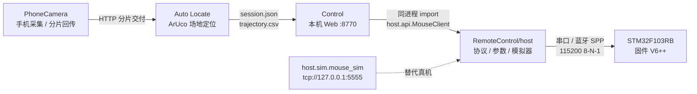

# MicroCar2026 · 电脑鼠竞速系统

面向 8×8 迷宫电脑鼠（Micromouse）竞速赛的完整工程实现：**视觉定位 → 整合上位机 → 串口/蓝牙链路 → STM32 固件**。
四个子系统可各自独立运行，串联后构成「录制/采集 → 定位解算 → 参数标定 → 发车 → 复盘」的闭环。


---

## 1. 概述

电脑鼠需在迷宫中完成探索、建图与最短路径冲刺，成绩取决于三件事：车体运动精度、参数整定质量、以及跑完后能否可靠复盘。
本工程将后两件事移到 PC 侧：固件只保留 1 ms 中断内的确定性控制与链路协议引擎，PC 侧负责观测、参数、记录与可视化。

系统由四个主子系统组成，另有可选的手机采集端；依赖方向单一，任一层可替换：

| 子系统 | 职责 | 技术栈 | 版本 |
|---|---|---|---|
| [`Auto Locate/`](Auto%20Locate/) | 由单张图像或一段视频解算场地中央 0 号标记的位姿 | Python + OpenCV（ArUco contrib） | `1.2.0` |
| [`Control/`](Control/) | 整合上位机：设备会话、参数、发车、记录、回放 | Python（aiohttp）+ 原生 JS，本机 Web | 改版四十七 |
| [`RemoteControl/host`](RemoteControl/host/) | 严格停等的命令/遥测通道、参数镜像、设备模拟器 | Python（pyserial） | `2.14.0` |
| [`RemoteControl/code_competition*`](RemoteControl/) | 运动控制、传感、链路协议、比赛策略 | C（Keil MDK，STM32F103RB） | PROTO 10 / FW 314 |
| [`PhoneCamera/`](PhoneCamera/) | 手机端锁定参数取帧与分片回传（可选组件，已退出主链路） | Kotlin（Camera2）+ Python（aiohttp） | `1.15.0` |

## 2. 主要特性

| 特性 | 实现方式 |
|---|---|
| 无需相机内参的场地定位 | 四角 ArUco 标记（`DICT_4X4_1000`）构建场地坐标系，无标定单应解算；可选棋盘格标定作交叉校验 |
| 亚毫米级定位误差 | 角点亚像素精化 + 多帧融合；合成真值 20 场景位置误差均值 0.43 mm |
| 在线调参 | 41 项参数经串口读写（Q16.16），写后自动回读校验，`SAVE` 落 Flash 掉电保留 |
| 帧级建图同步 | 遥测帧捎带 `mapd` 增量（每帧 3 条 × 2 B，带绝对坐标），可逐帧重放迷宫而非只看终态快照 |
| 无硬件可验证 | 设备模拟器与固件协议逐字节一致，`drill.py --sim` 覆盖 68 条端到端判据 |
| 可复算的精度基线 | 四个比赛档 hex 的 SHA-256 作为红线，重编后自动比对 |

## 3. 系统架构



两条集成边界：

- **`Control` ↔ `host`：同进程 import。** 同一 asyncio 事件循环，`MouseClient` 自建回调线程；串口往返与磁盘扫描一律 `run_in_executor`，端点函数零阻塞。
- **`Control` ↔ `Auto Locate`：子进程。** 通过 `Control/tools/video_session.py` 以会话方式调用，超时与取消互不影响。该薄壳负责转交 `--config`，直接调用 `aruco_locator.session` 会退回内置默认配置。

细节见 [`docs/系统架构.md`](docs/系统架构.md)。

## 4. 仓库结构

```
.
├── README.md                       本文件
├── requirements.txt                运行时依赖
├── requirements-optional.txt       可选依赖（GUI / 精化 / 二维码）
├── docs/                           跨模块文档：架构、安装运行、版本发布、硬件场地
├── Auto Locate/                    ArUco 场地定位库（可独立 import 或命令行调用）
│   ├── aruco_locator/              检测 → 亚像素角点 → 单应解算 → 位姿 → 迷宫融合
│   ├── docs/                       接口、参数手册、验证报告；历史评估见 docs/archive/
│   └── samples/                    4K 评估素材（大文件，未入库）
├── Control/                        整合上位机（本机 Web，app.py 为唯一入口）
│   ├── control/                    后端 adapters / api / store 与前端静态资源
│   ├── tools/                      preflight、drill、browser_check、接口一致性校验
│   └── docs/                       设计方案、模块总览、接口对照表
├── RemoteControl/                  链路层、上位机库与固件工程
│   ├── host/                       PC 上位机库与 30 个验收脚本
│   ├── code_competition - V6++/    当前工作副本：五 Target，含回程补搜与远程档
│   ├── code_competition - V6+/     前一步：V6 算法 + 远程档移植
│   ├── code_competition/           旧双档基线，红线 hex 出处
│   ├── code_stm32f1_mouse/         课程原版固件（MAZETYPE 7），仅作参考
│   └── docs/                       通信协议规格、算法详解、工具与校验
├── PhoneCamera/                    手机采集端（Android）与 PC 接收服务
├── code_competition_搜索连续转弯九成速_V6_20261029/
│                                   10-29 交付快照（仅比赛档）
└── 课件/                           电脑鼠参数调整表（参数表 41 项来源）
```

五套固件工程并存是刻意保留的：分别对应当前工作副本、迁移前一步、旧基线、课程原版与交付快照。
各工程的定位、Target 与红线基线见 [`docs/版本与发布.md`](docs/版本与发布.md#2-固件五档与红线)。

## 5. 环境要求

| 项 | 要求 |
|---|---|
| 操作系统 | Windows 10/11（脚本、路径与串口命名按 Windows 编写；纯 Python 部分未在 Linux/macOS 验证） |
| Python | ≥ 3.10；本工程开发与验证使用 3.12.13 |
| Python 依赖 | 见 `requirements.txt`。**必须使用 `opencv-contrib-python`**，`opencv-python` 不含 `cv2.aruco` |
| 固件编译 | Keil MDK 5（UV4，ARMCC V5.06，C90），目标 STM32F103RB |
| 采集端构建 | JDK 17、Gradle 8.9、Android SDK 34（`compileSdk 34` / `minSdk 24`） |
| 硬件（可选） | 电脑鼠整车、USB 转 TTL（CH340）或蓝牙 SPP 模块、J-Link |

除固件编译与采集端构建外，其余功能不需要任何硬件。

## 6. 安装

```bash
git clone git@github.com:Tehile/MicroCar2026.git
cd MicroCar2026

python -m venv .venv
.venv\Scripts\activate            # Windows；Linux/macOS 用 source .venv/bin/activate
python -m pip install -U pip
pip install -r requirements.txt
```

使用 conda 亦可，环境名与路径无约束：

```bash
conda create -n micromouse python=3.12 -y
conda activate micromouse
pip install -r requirements.txt
```

按需安装可选依赖（桌面 GUI、定位精化、二维码）：

```bash
pip install -r requirements-optional.txt
```

安装后自检：

```bash
cd Control
python tools/preflight.py          # 依赖 / 上游可导入 / 串口 / 端口，退出码 0 为通过
```

## 7. 快速开始

### 7.1 无硬件：启动上位机与设备模拟器

```bash
# 终端 A：设备模拟器（协议与固件逐字节一致）
cd RemoteControl/host
python -m host.sim.mouse_sim            # 监听 127.0.0.1:5555

# 终端 B：整合上位机
cd Control
python app.py                           # http://127.0.0.1:8770
```

在界面顶栏「电脑鼠」中选择 `tcp://127.0.0.1:5555` 连接，即可查看遥测波形、参数表与迷宫回放。

一条命令完成端到端判据验收（自动起模拟器）：

```bash
cd Control
python tools/drill.py --sim             # I1~I68
```

### 7.2 离线定位：视频 → 轨迹

```bash
cd "Auto Locate"
python -m aruco_locator.cli --source /path/to/run.mp4 \
                            --out out/run1 -c config.yaml
```

产物为 `out/run1/results.csv`（逐帧位姿）与 `results.jsonl`（逐帧明细）。会话级调用
（`session.json` + `trajectory.csv`，供上位机与外部程序使用）见
[`docs/会话级接口规范-视频文件处理.md`](Auto%20Locate/docs/会话级接口规范-视频文件处理.md)。

`Auto Locate/samples/` 为本地评估素材，未纳入版本控制。无素材时可先用合成真值验证安装与解算链路：

```bash
python selftest_synthetic.py
```

### 7.3 连接实机

1. 接 USB 转 TTL（CH340）或配对蓝牙 SPP，串口参数 **115200 8-N-1**。
2. 连接后首页应收到 `PONG`，远程档 `PROTO=10`、`FW=314`；无响应通常是烧写了比赛档（比赛档不响应串口命令）。
3. 界面 `#/live` 查看波形与四灯状态，`#/params` 在线调参，`#/race` 发车与收车。
4. 收车以动作码归零为准，`ACK OK` 仅表示命令被接收。

仅需命令行时：

```bash
cd RemoteControl/host
python selftest.py                      # 协议断言，无需硬件
python basic_cmd_smoke.py COM7          # 真机基础指令
python link_pull_evt.py COM7 --mark-n 2 # 长跑取流（事件触发，在途恒 ≤ 1）
```

### 7.4 编译固件

```bash
cd RemoteControl
python build_v6pp_modes.py              # 五档全量重编，并比对 REDLINE 哈希
```

Keil 中打开 `RemoteControl/code_competition - V6++/USER/TEST.uvprojx`，
比赛档选 `V6_4mm`（默认），上位机接管选 `Target_Remote`。切换 Target 后须 Rebuild。

完整步骤、参数说明与故障处理见 [`docs/安装与运行.md`](docs/安装与运行.md)。

## 8. 验证

| 模块 | 命令 | 覆盖范围 |
|---|---|---|
| `Control` | `python tools/preflight.py` | 环境、依赖、上游可导入、串口与端口 |
| `Control` | `python tools/drill.py --sim` | 端到端判据（最近一次：67 通过 / 0 失败 / 1 跳过） |
| `Control` | `python tools/check_iface_table.py` | 文档、路由与上游符号三方一致 |
| `Auto Locate` | `python selftest_synthetic.py` | 合成真值场景（最近一次：20 场景，位置误差均值 0.43 mm） |
| `Auto Locate` | `python tools/check_api_surface.py` | 公开接口冻结面 |
| `host` | `python selftest.py` | 协议断言，45/45 |
| `PhoneCamera` | `python pc/test_server.py` | 接收服务协议（219 项全通过） |

`RemoteControl/host/selftest.py --e2e` 存在已知缺陷，见 §9。

## 9. 已知问题

| 问题 | 影响 | 状态 |
|---|---|---|
| `host/selftest.py --e2e` 在连续拉取后于 `GET ALL` 超时 | 仅影响该自检项，纯协议自检正常 | 既有缺陷（已用 `pre-release-20261114` 快照复现）。规避：先停流再 `GET ALL`，或改用 `link_pull_evt.py` |
| `Control.__version__` 恒为 `0.1.0` | 不能据此判断版本 | 占位值；以 `Control/README.md` 改版序为准 |
| Android `versionName` 为 `1.0` | 与 App 内部版本不一致 | 以代码常量 `LockedCaptureProbe.APP_VERSION` 为准 |
| `PhoneCamera` 实时帧流已从主链路下线 | 位置数据仅来自「视频 → Auto Locate」 | 采集端保留用于机型复验与原始帧取证 |

## 10. 安全与操作约束

以下约束来自实测，属硬性要求：

| 约束 | 说明 |
|---|---|
| 发车前独立校验电池 | 上位机自行读取电压，低于 7000 mV 拒绝发车，不依赖车端判断 |
| 收车需确认动作码归零 | `ACK OK` 不代表已停止 |
| 链路完全断开时软件无法收车 | `STOP → ESTOP → RESET` 均超时，只能人工停车并断电 |
| 遥测帧率存在硬上限 | 上行帧率 ≈ N / RTT（RTT ≈ 300 ms）；`N=4` 约 13 Hz、`N=5` 约 17 Hz 为安全上限，`N=6` 会在十余秒内灌满透传模块，需物理断电 |
| 禁止连续发流 | 不得使用 `RATE FIX <hz>`，一律用批量 `RATE PULL <n> <t>` |
| 上电须静止 | 陀螺零偏标定为阻塞流程，车体运动时上电将导致标定失败 |
| 调试时轮子悬空 | 「维护 → 擦除」不可逆 |

## 11. 文档

| 文档 | 内容 |
|---|---|
| [`docs/系统架构.md`](docs/系统架构.md) | 分层职责、两条集成边界、五条数据流、三套时钟 |
| [`docs/安装与运行.md`](docs/安装与运行.md) | 安装、四种使用路径、固件编译、故障排查 |
| [`docs/版本与发布.md`](docs/版本与发布.md) | 版本矩阵、五档 Target、红线基线、校验与归档流程 |
| [`docs/硬件与场地.md`](docs/硬件与场地.md) | 场地几何、标记布局与差高视差、车体、接线、相机 |
| [`Auto Locate/README.md`](Auto%20Locate/README.md) | 定位算法原理、精度实测、参数 |
| [`Auto Locate/docs/API.md`](Auto%20Locate/docs/API.md) | 定位库接口契约 |
| [`Control/README.md`](Control/README.md) | 上位机模块组成与九页界面 |
| [`Control/docs/接口对照表.md`](Control/docs/接口对照表.md) | HTTP/WS 端点与上游符号对照 |
| [`RemoteControl/docs/通信协议规格.md`](RemoteControl/docs/通信协议规格.md) | 帧布局、命令表、参数表 |
| [`PhoneCamera/README.md`](PhoneCamera/README.md) | 采集端与接收服务、分片交付协议 |

## 12. 版本

| 项 | 当前值 | 权威位置 |
|---|---|---|
| `Auto Locate` | `1.2.0` | `aruco_locator/__init__.py::__version__` |
| `host`（API） | `2.14.0` | `host/__init__.py::__version__` |
| 固件远程档 | PROTO 10 / FW 314 | 连接后 `PONG` 返回 |
| 固件比赛档 | V6++，`V6_0mm/2mm/4mm/6mm` | `USER/TEST.uvoptx` 的 `IsCurrentTarget` |
| `PhoneCamera` | `1.15.0`（App / PC 相同） | `LockedCaptureProbe.APP_VERSION`、`SERVER_VERSION` |

## 13. 许可与第三方组件

本仓库为参赛与课程工程，未附加开源许可证，保留所有权利。

第三方组件：ArUco 字典 `DICT_4X4_1000`（OpenCV contrib）、ZXing core 3.5.3（扫码，以 jar 形式随 App 入库）、
CH340 串口驱动（随硬件提供）。课程讲义与比赛资料不在本仓库内。
