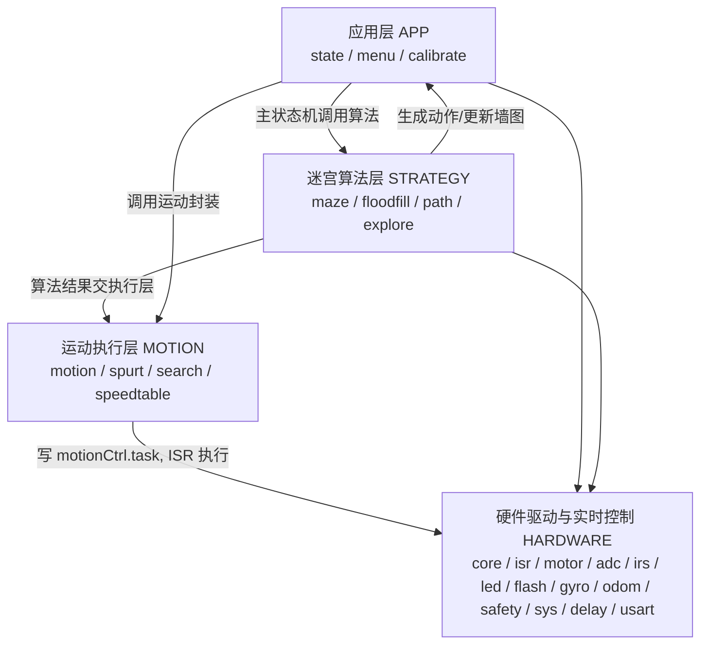
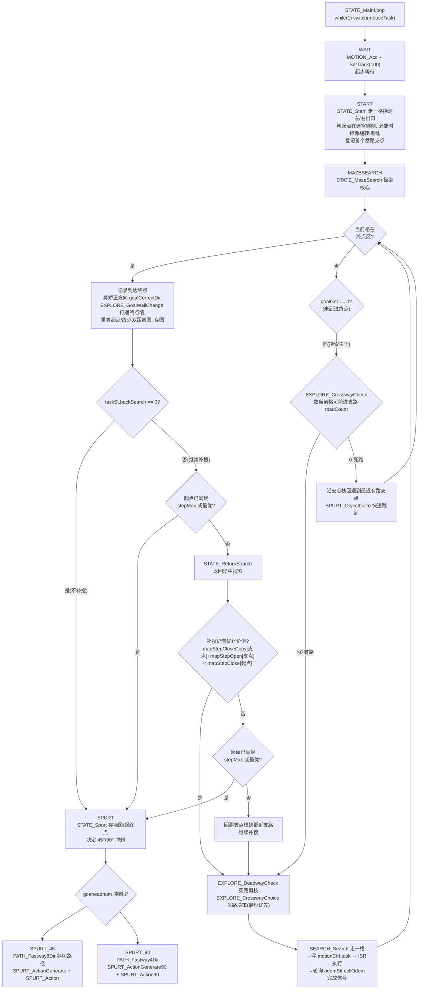
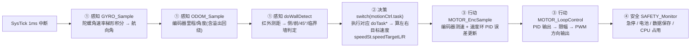
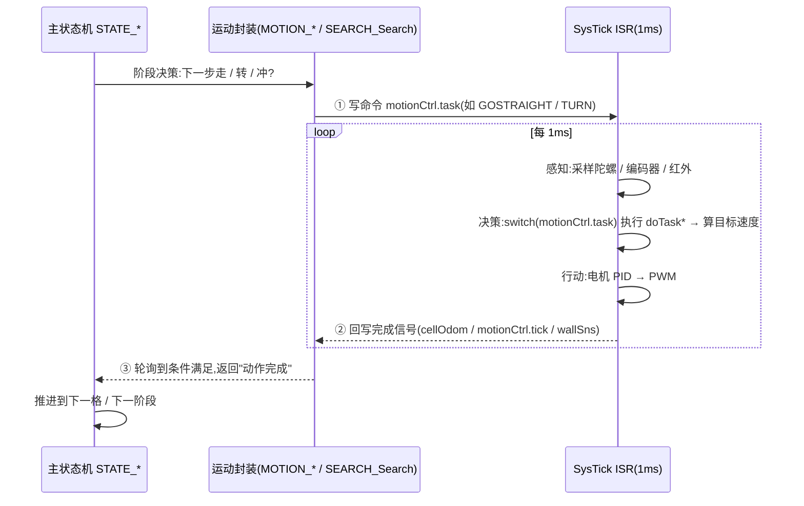
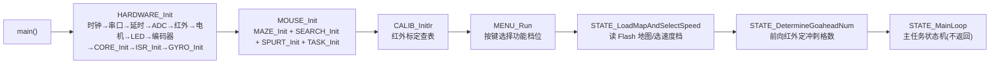
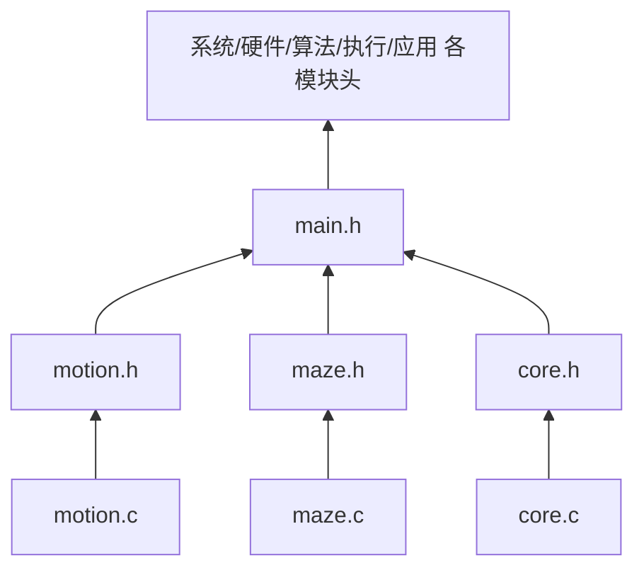

# 系统架构设计

本文档描述 `code_stm32f1_mouse`(STM32F103RB 电脑鼠)的**当前**分层架构、前后台协作机制与模块职责。代码组织为五个目录,遵循"算法决策与实时执行分离"的**前后台系统**设计:前台主循环负责"想清楚下一步做什么",后台 SysTick 1ms 中断负责"把这 1ms 的运动做出来"。

## 1. 分层架构总览

调用方向:应用层决策 → 算法层计算(建图/最短路/探索法则)→ 运动执行层封装 → 硬件层(ISR)实时执行。

## 2. 目录结构与模块职责

### APP/ 应用层

| 文件 | 承载内容 |
|------|----------|
| state.c / state.h | 主任务状态机 `STATE_MainLoop`、`STATE_Start/MazeSearch/ReturnSearch/Spurt/Spurt45/Spurt90`、赛前准备 `STATE_LoadMapAndSelectSpeed`、`STATE_DetermineGoaheadNum` |
| menu.c / menu.h | `MENU_Run` 按键菜单(0–8 档) |
| calibrate.c / calibrate.h | `CALIB_*` 红外/陀螺/传感器标定 |

### STRATEGY/ 迷宫算法层

| 文件 | 承载内容 |
|------|----------|
| maze.c / maze.h | 迷宫状态 `mazeState`(坐标/方向/任务码/墙图/栈数组)、`MAZE_Init`、`MAZE_CoorUpdate/Fast`、`MAZE_WallCheck` 墙检测与镜像同步、`MAZE_BreakOrNot`、墙位/方向编码宏 |
| floodfill.c / floodfill.h | `FLOODFILL_Close/Open/CloseCopy/OpenCopy` 洪水填充距离图(全闭图等高值/全开图最短路) |
| path.c / path.h | `PATH_Fastway8Dir/4Dir/BackPath` 8/4 方向最短路路径生成 |
| explore.c / explore.h | `EXPLORE_*` 六种贴墙法则、中心法则、岔路决策、死路剪枝、回退点选择 |

### MOTION/ 运动执行层

| 文件 | 承载内容 |
|------|----------|
| motion.c / motion.h | `MOTION_*` 直线/转弯/原地转向/加减速、转弯参数表 `turnParamTable` |
| spurt.c / spurt.h | `SPURT_*` 冲刺动作序列生成与执行、档位增益、`SpurtAction_t`/`SpurtSpeed_t` |
| search.c / search.h | `SEARCH_Search` 搜索走格、`SEARCH_HasWall/NoWall` 格内驱动方式 |
| speedtable.c / speedtable.h | 391 点转弯速度查找表(前馈 gyro/vl/vr) |

### HARDWARE/ 硬件驱动与实时控制

| 文件 | 承载内容 |
|------|----------|
| core.c / core.h | 核心类型容器(全部结构体类型与全局实例定义)、`CORE_Init`、PID 增益/墙判阈值宏 |
| isr.c / isr.h | `ISR_Init`、`SysTick_Handler`(1ms 调度)、21 个 `doTask*` 运动函数、`doWallDetect` |
| motor.c / motor.h | `MOTOR_*` 电机 PWM、编码器采样、速度环 PID |
| adc.c / adc.h | `ADC_*` 采样 |
| irs.c / irs.h | `IR_*` 红外测距与标定 |
| led.c / led.h | `LED_*` 显示、按键 |
| flash.c / flash.h | Flash 底层驱动 `FLASH_*` 与运行数据读写 |
| gyro.c / gyro.h | `GYRO_Init`、`GYRO_Sample` 陀螺角速率积分 |
| odom.c / odom.h | `ODOM_Sample` 编码器里程计 |
| safety.c / safety.h | `SAFETY_Monitor` 急停/电池/CPU 监控 |
| sys.c / sys.h | `SYS_ClockInit` 时钟初始化、位带操作宏 |
| delay.c / delay.h | `DELAY_*` 微秒/毫秒延时 |
| usart.c / usart.h | `USART_*` 串口、printf 重定向 |

### USER/ 入口层

| 文件 | 承载内容 |
|------|----------|
| main.c / main.h | `main()` 启动流程、`MOUSE_Init`/`HARDWARE_Init`/`TASK_Init`;聚合头 main.h 统一包含各模块头 |

## 3. 前后台系统(两张详图)

电脑鼠是典型的**前后台系统**:主循环(前台)是"指挥官",SysTick 1ms 中断(后台)是"执行者"。两者之间没有消息队列或事件回调,靠**共享变量握手**(见 §3.3)。

### 3.1 图A —— 前台系统:主循环状态机干什么

前台的全部工作就是 `STATE_MainLoop` 里的 `while(1) switch(mazeState.mouseTask)`:按当前阶段码把控制权交给对应的 `STATE_*` 阶段函数。每个阶段函数"拥有"一段流程,决定做什么、何时结束、下一阶段交给谁。

> 关键点:前台**从不亲自驱动电机**。它只决策,然后调用运动封装函数(走一格/转弯/冲刺直行),封装函数写 `motionCtrl.task` 交给 ISR,自己忙等完成信号,封装返回"做完了"才推进下一步。

### 3.2 图B —— 后台系统:SysTick 1ms 中断干什么

后台的工作在 `SysTick_Handler` 里,每个 1ms 按固定的"感知 → 决策 → 行动 → 安全"流水线执行一次:

**① 感知** —— 采集本毫秒的"现实":陀螺航向角、编码器里程/角度、红外四方向距离,并判定墙位。

**② 决策** —— `switch(motionCtrl.task)` 执行对应的 `doTask*`:每个 doTask 是一套"这 1ms 该怎么开"的算式,依据刚采到的角度/墙距/里程算出左右轮**目标速度**。21 个 doTask 与任务码的映射:

| 分类 | 任务码 → doTask | 职责 |
|------|-----------------|------|
| 基础运动 | GOSTRAIGHT=1 → doTaskGoStraight | 闭眼直线:陀螺角 PD |
| | TURN=2 → doTaskTurn | 转弯:查前馈表 + 角度 PD |
| | TURNAROUND=4 → doTaskTurnAround | 原地 180°:两阶段(查表转向→陀螺对正) |
| | STOP=5 → doTaskStop | 刹车:负斜坡减速 |
| | STRAIGHT45=17 → doTaskStraight45 | 45° 斜线冲刺:侧/前红外双项误差 |
| 转弯前后 | BEFORE90TURN=27 / BEFORE180TURN=28 → doTaskBefore90/180Turn | 转弯前对正与定位 |
| 智能直行 | SMARTSTRAIGHT=30 → doTaskSmartStraight | 智能直线:有墙用红外/无墙用陀螺 |
| | SMARTSTRAIGHTFAST=32 → doTaskSmartStraightFast | 搜索直线:懒惰贴墙侧 + 分档增益 |
| | STRAIGHTEYECLOSECOORADJ=33 / STRAIGHTPOLE=34 | 闭眼+纵向矫正 / 沿杆直线 |
| 加减速/贴墙 | ACC=35 / SLOWDOWN=36 / SPEEDUP=37 | 加速/减速/提速 |
| | KEEPWALLDISTANCE=38 / POINTTURN90=39 / FORWARDIRTEST=41 | 贴墙/原地90/前向对正 |
| 冲刺 | SPURT90BLIND=42 → doTaskSpurt90Blind | 90° 冲刺闭眼:陀螺 PD |
| | SPURT90IR=43 → doTaskSpurt90Ir | 90° 冲刺睁眼:红外 PD |
| | SMARTSTRAIGHTSPURT=44 / SMARTSTRAIGHTSPURTL=45 | 转弯前补全直线 |

**③ 行动** —— `MOTOR_EncSample` 测实时速度并更新 PID 误差,`MOTOR_LoopControl` 把"目标速度 vs 实时速度"跑 PID 闭环,输出 PWM 驱动电机。

**④ 安全** —— `SAFETY_Monitor` 检查急停/电池/运行数据保存/CPU 占用。

### 3.3 握手:命令下行,完成信号上行

运动封装函数与 ISR 之间靠**共享变量**完成握手:

1. **命令下行**:封装函数写运动任务码 `motionCtrl.task`,告诉 ISR"接下来执行哪种运动"。
2. **完成信号上行**:封装函数随后**忙等轮询** ISR 每个毫秒回写的状态量,条件满足即返回:

| 共享变量 | 方向 | 语义 | 典型等待条件 |
|----------|------|------|--------------|
| `motionCtrl.task` | 前台 → ISR | 运动任务码(MotionTask_t) | 赋值即开始执行 |
| `odomStr.cellOdom` | ISR → 前台 | 格内已走里程(0→180mm) | `while(cellOdom < 180)` 走满一格 |
| `motionCtrl.tick` | ISR → 前台 | 动作节拍计数 | `while(tick < 50)` 保持 50ms |
| `wallSns.left/right/front` | ISR → 前台 | 侧/前墙有无判定 | 转弯前确认侧墙 |
| `speedSt.avgSpeed` | ISR → 前台 | 实时平均速度 | 加减速到位判断 |

## 4. 启动流程

> 初始化顺序红线:`ISR_Init`(开启 SysTick 1ms)必须放在所有外设初始化之后;`CORE_Init` 的速度/PID/墙检配置须在 ISR_Init 之前(ISR 每周期读);`GYRO_Init` 的陀螺零点校准须在 ISR_Init 之后(依赖 ISR 递增校正计数)。

## 5. 全局状态组织

全局运行状态以结构体形式组织,类型集中定义于 `core.h`,实例定义于 `core.c` 及各模块 .c。

| 结构体 | 实例 | 定义位置 | 承载内容 |
|--------|------|----------|----------|
| MazeState | mazeState | maze.c | 迷宫坐标/方向/任务码/墙图/路径栈 |
| MotionCtrl | motionCtrl | core.c | 运动状态机:pidErr/任务码/步进/节拍 |
| OdomStruct | odomStr | core.c | 编码器里程与角度 |
| GyroStruct | gyroStr | gyro.c | 陀螺角速率/积分角度/零偏 |
| IrDist | irDist | core.c | 红外前/左/右距离 |
| SpeedConfig | speedCfg | core.c | 各场景速度配置 |
| SpeedState | speedSt | core.c | 左右目标速度/平均速度/PWM |
| PidGainConfig | pidGain | core.c | PID 增益集合 |
| TurnTable | turnTbl | core.c | 转弯查表指针 |
| WallSensor | wallSns | core.c | 墙检测状态与阈值 |
| EmergMonitor / BattMonitor / CpuMonitor | emergMon / battMon / cpuMon | core.c / isr.c | 急停/电池/CPU 监控 |
| SysConfig / FlashState | sysCfg / flashSt | isr.c / core.c | 系统配置常量 / Flash 状态 |
| TaskState | taskSt | main.c | 任务状态:goaheadnum/backSearch/spurtFlag |
| SpurtConfig | spurtCfg | core.c | 冲刺 PID 参数 |
| SpurtSpeedConfig | spurtSpd | spurt.c | 冲刺速度常量 |
| SearchState | searchSt | search.c | 搜索/转弯偏移/速度档 |
| SearchStateMachine | searchSm | state.c | 搜索状态机跨周期变量(static) |

## 6. 头文件聚合模式

各模块 `.c` 仅包含自己的 `.h`,各 `.h` 统一包含聚合头 `main.h`;`main.h` 按层依次包含系统/硬件/核心控制/算法/执行/应用各模块头,并定义位带操作宏。

该模式保证全项目符号可见性一致,新增模块只需在 `main.h` 登记即可全局访问。
